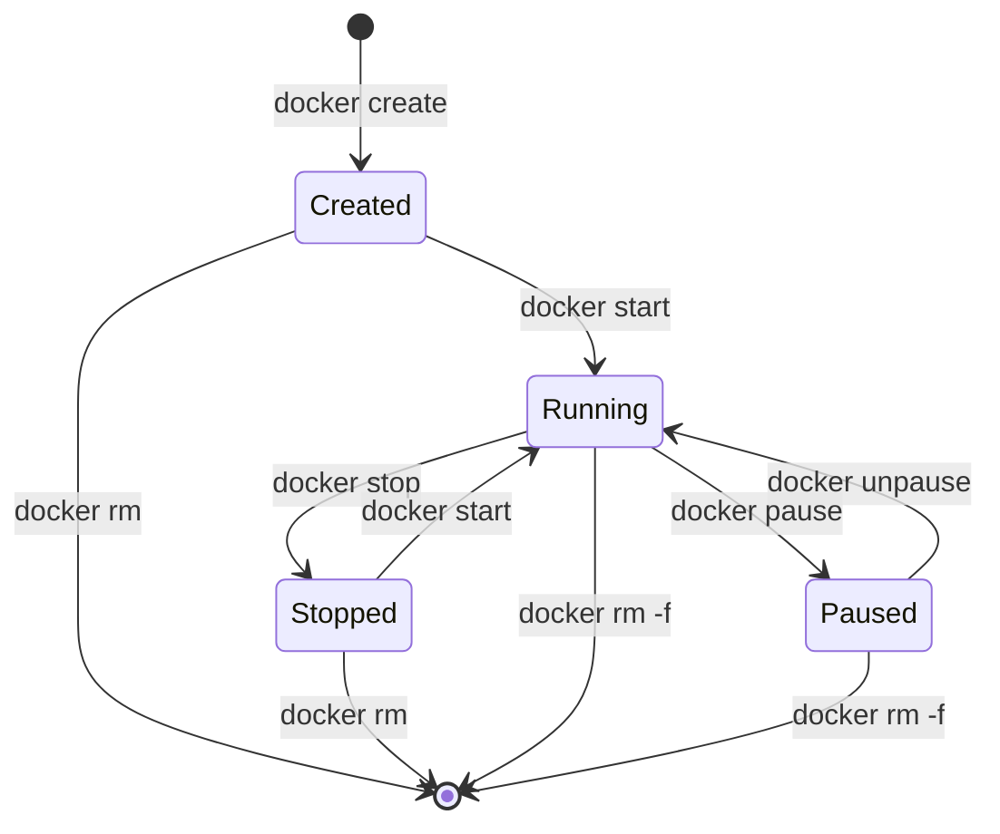

# Phase 00: Foundations - Visual Specifications

> **Diagram and visual aid specifications for Docker fundamentals**

## 🎯 Visual Overview

Phase 00 requires several key visuals to illustrate core Docker concepts. Each visual serves a specific pedagogical purpose and should follow consistent styling.

## 🎨 Visual Style Guidelines

### Consistency Rules
- **Colors**: Use Docker blue (#2496ED) for Docker elements, gray for host
- **Typography**: Sans-serif fonts, minimum 12pt for readability  
- **Layout**: Left-to-right flow, clear separation between concepts
- **Icons**: Simple, recognizable symbols (boxes for containers, layers for images)
- **Annotations**: Arrows with clear labels, avoid cluttered text

### Accessibility Requirements
- **Alt-text**: Descriptive text for each visual
- **Contrast**: Ensure sufficient contrast for colorblind users
- **Size**: Readable at 800px width minimum

---

## 📊 Visual 1: Layer Cake Architecture

**Title**: Docker Image Layers  
**Purpose**: Show how images are built incrementally with layers  
**Type**: PNG diagram  
**Placement**: README.md, Topic Deep Dive section

### Rough Sketch
```
    [Application Layer]     ← Your app code
    [Dependencies Layer]    ← npm install, pip install, etc.
    [Runtime Layer]        ← Node.js, Python, etc.
    [OS Layer]            ← Ubuntu, Alpine, etc.
    
    Image: Read-only layers stacked
    
    Container adds:
    [Read-Write Layer]     ← Container filesystem changes
    [Image Layers Below]   ← Same as above, but read-only
```

### Implementation Details
- **Dimensions**: 600x400px
- **Format**: PNG with transparent background
- **Labels**: Each layer clearly labeled with purpose
- **Visual metaphor**: Cake layers or building blocks
- **Emphasis**: Show read-only nature of image layers

### Alt-text
"Docker image architecture showing four stacked layers: OS layer at bottom, runtime layer, dependencies layer, and application layer at top. Container adds a thin read-write layer on top of the read-only image layers."

---

## 📊 Visual 2: Container Lifecycle Swimlane

**Title**: Container State Machine  
**Purpose**: Show all container states and legal transitions  
**Type**: Mermaid diagram  
**Placement**: README.md and lab.md

### Mermaid Code


### Visual Details
- **States**: Created, Running, Paused, Stopped, Removed
- **Transitions**: All legal paths between states
- **Commands**: Docker command for each transition
- **Color coding**: Different colors for each state type

### Alt-text
"Container lifecycle state diagram showing transitions between Created, Running, Paused, and Stopped states, with docker commands labeled on each transition arrow."

---

## 📊 Visual 3: Host-Container Port Diagram

**Title**: Network Boundaries & Port Publishing  
**Purpose**: Illustrate host-container network relationship  
**Type**: PNG diagram  
**Placement**: lab.md, Lab 3 section

### Rough Sketch
```
Host System (Your Computer)
┌─────────────────────────────────────────┐
│  Application (curl, browser)            │
│  ↓ http://localhost:8080                │
│                                         │
│  Host Port 8080 ←→ Container Port 80    │
│                     ↓                   │
│  ┌─────────────────────────────────┐    │
│  │ Container (172.17.0.x)          │    │
│  │ ┌─────────────────────────────┐ │    │
│  │ │ nginx process               │ │    │
│  │ │ listening on port 80        │ │    │
│  │ └─────────────────────────────┘ │    │
│  └─────────────────────────────────┘    │
└─────────────────────────────────────────┘
```

### Implementation Details
- **Show**: Host IP, container IP, port mapping
- **Arrows**: Clear data flow direction
- **Labels**: Port numbers, IP addresses, process names
- **Boundaries**: Visual separation between host and container
- **Access methods**: Both localhost:8080 and container IP:80

### Alt-text
"Network diagram showing host system containing a container. Host port 8080 maps to container port 80 where nginx listens. Shows both external access via localhost:8080 and internal container IP access."

---

## 📊 Visual 4: Images vs Containers Relationship

**Title**: Template vs Instance Relationship  
**Purpose**: Clarify the fundamental Docker concept  
**Type**: PNG diagram  
**Placement**: README.md, Concept Map section

### Rough Sketch
```
Docker Image (nginx:alpine)
┌─────────────────────┐
│ [Template/Blueprint] │ ──────┐
│ • Immutable         │       │
│ • Layered           │       │ docker run
│ • Shareable         │       │
└─────────────────────┘       │
                              │
                              ▼
              ┌─────────────────────────┐
              │     Containers         │
              │                        │
              │ ┌─────┐ ┌─────┐ ┌─────┐ │
              │ │ C1  │ │ C2  │ │ C3  │ │
              │ │ Run │ │ Stop│ │ Run │ │
              │ └─────┘ └─────┘ └─────┘ │
              │                        │
              │ • Mutable state        │
              │ • Individual lifecycle │
              │ • Resource allocation  │
              └─────────────────────────┘
```

### Implementation Details
- **Image representation**: Single box, emphasize immutability
- **Container representation**: Multiple instances with different states
- **Relationship arrow**: Clear derivation from image to containers
- **State indicators**: Show containers can have different states
- **Key properties**: Listed for both images and containers

### Alt-text
"Diagram showing one Docker image as a template connected to multiple container instances. Image labeled as immutable template, containers shown with different states and individual properties."

---

## 📊 Visual 5: Reference Format Comparison

**Title**: Tags vs Digests  
**Purpose**: Show different image reference formats  
**Type**: Comparison table/diagram  
**Placement**: lab.md, Lab 4 section

### Table Format
```
| Reference Type | Example | Mutability | Use Case |
|---------------|---------|------------|----------|
| Tag | nginx:latest | Mutable | Development |
| Tag | nginx:1.21 | Semi-stable | Versioning |
| Digest | nginx@sha256:abc123... | Immutable | Production |
```

### Visual Enhancement
- **Timeline**: Show how tags can change over time
- **Lock icon**: For immutable digests
- **Update arrow**: For mutable tags
- **Scenarios**: Dev vs prod deployment examples

### Alt-text
"Comparison table showing three types of Docker image references: mutable tags for development, version tags for releases, and immutable digests for production deployments."

---

## 🎨 Implementation Plan

### Phase 1: Essential Diagrams
1. **Container Lifecycle** (Mermaid) - Implement first, easiest to create
2. **Images vs Containers** (PNG) - Core concept, high priority
3. **Port Mapping** (PNG) - Critical for hands-on labs

### Phase 2: Enhancement Diagrams  
4. **Layer Architecture** (PNG) - Deeper understanding
5. **Reference Comparison** (Table/PNG) - Advanced concept

### Tools & Resources
- **Mermaid**: For state diagrams and flowcharts
- **Draw.io/Lucidchart**: For complex PNG diagrams  
- **Figma**: For polished, branded visuals
- **ASCII art**: For simple text-based diagrams in markdown

## 📏 Placement Guidelines

### README.md Visuals
- **Images vs Containers**: In "Topic Deep Dives" section
- **Container Lifecycle**: In "Container Lifecycle Management" topic

### lab.md Visuals  
- **Port Mapping**: In Lab 3 "Try It" section
- **Reference Comparison**: In Lab 4 summary

### verify.rules.md Visuals
- **State diagram reference**: Link to lifecycle visual
- **Port testing diagram**: Reference to Lab 3 visual

## 🔍 Quality Checklist

For each visual:
- [ ] Serves clear pedagogical purpose
- [ ] Readable at target size
- [ ] Consistent with style guidelines
- [ ] Includes descriptive alt-text
- [ ] Properly placed in content flow
- [ ] Enhances rather than duplicates text

## 📱 Responsive Considerations

- **Mobile viewing**: Ensure legibility on small screens
- **Print versions**: Work in black and white
- **High DPI**: Provide 2x versions for retina displays

---

> 💡 **Implementation Note**: Start with Mermaid diagrams (fastest to create), then create PNG diagrams using preferred tool. All visuals should be committed to `/visuals/phase-00/` directory.