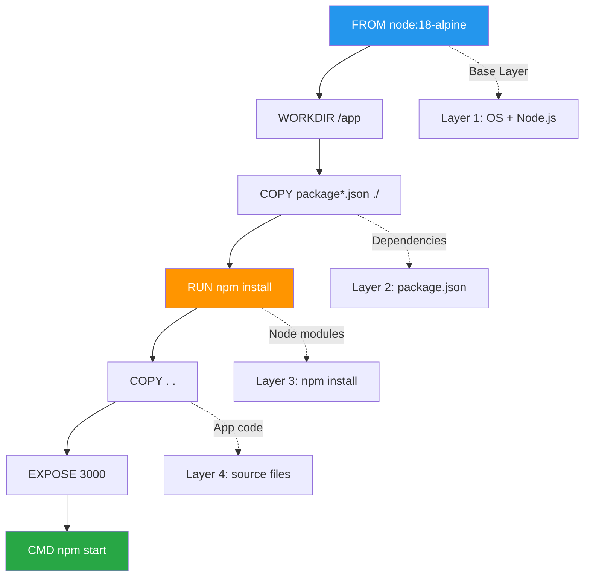

# Phase 01: Dockerfile Basics - Visual Specifications

> **Visual aids and diagrams for mastering Dockerfile creation and optimization**

## 🎯 Visual Overview

Phase 01 requires strategic visuals to illustrate Dockerfile concepts, build optimization, and best practices. These visuals should clarify complex concepts like layer caching, build context, and directive relationships.

## 🎨 Visual Style Guidelines

### Consistency with Phase 00
- **Colors**: Docker blue (#2496ED), warning orange (#FF9500), success green (#28A745)
- **Typography**: Clear, readable fonts with good contrast
- **Icons**: Consistent Docker/container iconography
- **Layout**: Logical flow from left to right or top to bottom

### Phase 01 Specific Elements
- **Layers**: Use stacked rectangles to show Docker layers
- **Build Steps**: Arrow-connected boxes for sequential operations
- **File Context**: Folder/file icons with inclusion/exclusion indicators
- **Caching**: Use checkmarks (✓) for cache hits, X for cache misses

---

## 📊 Visual 1: Dockerfile Directive Flow

**Title**: Dockerfile Build Process Flow  
**Purpose**: Show how Dockerfile directives create layers sequentially  
**Type**: Mermaid flowchart  
**Placement**: README.md, "Essential Directives" section

### Mermaid Code


### Implementation Details
- **Color coding**: FROM (blue), RUN commands (orange), final command (green)
- **Layer visualization**: Dotted lines connecting to layer representations
- **Progressive flow**: Top-to-bottom showing build sequence

### Alt-text
"Flowchart showing Dockerfile directive sequence from FROM to CMD, with corresponding Docker layers created at each step. Shows base layer, dependencies, installation, and application code layers."

---

## 📊 Visual 2: Layer Caching Strategy Comparison

**Title**: Build Caching: Efficient vs Inefficient Ordering  
**Purpose**: Illustrate why directive order matters for cache performance  
**Type**: Side-by-side comparison diagram (PNG)  
**Placement**: README.md and lab.md Lab 2 section

### Rough Sketch
```
INEFFICIENT ORDERING                 EFFICIENT ORDERING
┌─────────────────────┐              ┌─────────────────────┐
│ COPY . /app         │ ❌ Changes    │ COPY package*.json  │ ✓ Cached
│ (invalidates cache) │              │ (rarely changes)    │
├─────────────────────┤              ├─────────────────────┤  
│ RUN npm install    │ ❌ Rebuilds   │ RUN npm install    │ ✓ Cached
│ (every time)       │              │ (until pkg changes) │
└─────────────────────┘              ├─────────────────────┤
                                     │ COPY . /app        │ ❌ Rebuilds
Cache Hit Rate: 0%                   │ (only when needed) │
Build Time: ~60s                     └─────────────────────┘
                                     
                                     Cache Hit Rate: 80%
                                     Build Time: ~15s
```

### Implementation Details
- **Side-by-side layout**: Clear comparison of approaches
- **Visual indicators**: ✓ for cache hits, ❌ for cache misses
- **Performance metrics**: Show actual time/percentage improvements
- **Layer highlighting**: Different colors for cached vs rebuilt layers

### Alt-text
"Comparison diagram showing inefficient vs efficient Dockerfile layer ordering. Inefficient version copies all files first, causing npm install to rebuild on any change. Efficient version copies package.json first, allowing npm install to be cached when only source code changes."

---

## 📊 Visual 3: Build Context and .dockerignore

**Title**: Build Context Control with .dockerignore  
**Purpose**: Show what gets sent to Docker daemon with/without .dockerignore  
**Type**: Before/After diagram (PNG)  
**Placement**: lab.md Lab 3 section

### Rough Sketch
```
WITHOUT .dockerignore                WITH .dockerignore
┌─────────────────────┐              ┌─────────────────────┐
│ Project Directory   │              │ Project Directory   │
│                     │              │                     │
│ 📁 src/            │ ──────────►   │ 📁 src/            │ ──────────►
│ 📁 node_modules/   │ 🚫 SECURITY   │ 📁 node_modules/   │ ✓ EXCLUDED
│ 📁 .git/           │ 🚫 BLOAT      │ 📁 .git/           │ ✓ EXCLUDED  
│ 🔑 .env            │ 🚫 SECRETS    │ 🔑 .env            │ ✓ EXCLUDED
│ 📄 README.md       │ 🚫 UNNECESSARY │ 📄 README.md       │ ✓ EXCLUDED
│ 📊 logs/           │               │ 📊 logs/           │ ✓ EXCLUDED
└─────────────────────┘              └─────────────────────┘
       │                                      │
       ▼                                      ▼
┌─────────────────────┐              ┌─────────────────────┐
│ Docker Build Context│              │ Docker Build Context│
│ Size: 145MB         │              │ Size: 2MB          │
│ Files: 15,432       │              │ Files: 23          │
│ Security Risk: HIGH │              │ Security Risk: LOW │
└─────────────────────┘              └─────────────────────┘
```

### Implementation Details
- **File icons**: Clear visual representation of different file types
- **Color coding**: Red for excluded items, green for included
- **Metrics**: Show size and file count differences
- **Security indicators**: Highlight security implications

### Alt-text
"Before and after diagram showing project directory contents sent to Docker daemon. Without dockerignore, all files including node_modules, git files, and secrets are sent (145MB). With dockerignore, only necessary source files are sent (2MB)."

---

## 📊 Visual 4: CMD vs ENTRYPOINT Behavior Matrix

**Title**: CMD vs ENTRYPOINT: Execution Behavior Comparison  
**Purpose**: Clarify when to use CMD vs ENTRYPOINT vs combination  
**Type**: Decision matrix table with examples (PNG)  
**Placement**: README.md and lab.md Lab 4 section

### Table Layout
```
┌─────────────────┬──────────────────┬──────────────────┬────────────────────┐
│ Configuration   │ Default Run      │ With Arguments   │ Use Case          │
├─────────────────┼──────────────────┼──────────────────┼────────────────────┤
│ CMD only        │ ./app default    │ echo "hello"     │ Flexible command   │
│ CMD ["./app",   │                  │ (completely      │ (dev environments) │
│      "default"] │                  │  replaced)       │                    │
├─────────────────┼──────────────────┼──────────────────┼────────────────────┤
│ ENTRYPOINT only │ ./app            │ ./app hello      │ Fixed entry point  │
│ ENTRYPOINT      │                  │ (args appended)  │ (CLI tools)        │
│ ["./app"]       │                  │                  │                    │
├─────────────────┼──────────────────┼──────────────────┼────────────────────┤
│ Both combined   │ ./app default    │ ./app hello      │ Configurable app   │
│ ENTRYPOINT      │                  │ (CMD replaced,   │ with defaults      │
│ + CMD           │                  │  ENTRYPOINT kept)│ (production)       │
└─────────────────┴──────────────────┴──────────────────┴────────────────────┘

Decision Tree:
Need fixed entry point? ──NO──► Use CMD only
         │
        YES
         │
Need default args? ──NO──► Use ENTRYPOINT only  
         │
        YES
         │
         ▼
    Use both: ENTRYPOINT + CMD
```

### Implementation Details
- **Clear examples**: Show actual command execution
- **Decision flow**: Visual decision tree below table
- **Color coding**: Different colors for each configuration type
- **Real scenarios**: Practical use cases for each approach

### Alt-text
"Matrix comparing CMD, ENTRYPOINT, and combined usage showing default execution, behavior with arguments, and appropriate use cases. Includes decision tree for choosing the right approach."

---

## 📊 Visual 5: Dockerfile Optimization Strategies

**Title**: Size and Performance Optimization Techniques  
**Purpose**: Show before/after of common optimization techniques  
**Type**: Multi-panel comparison (PNG)  
**Placement**: README.md "Production Notes" section

### Layout Design
```
OPTIMIZATION TECHNIQUES

1. BASE IMAGE SELECTION
   ubuntu:latest (78MB) → alpine:latest (5MB) → scratch (0MB)
   [■■■■■■■■] → [■] → [minimal bar]

2. LAYER CONSOLIDATION  
   Bad:  RUN apt-get update     ┐
   Bad:  RUN apt-get install   ├─ 3 layers, cache invalidation
   Bad:  RUN rm -rf /var/...   ┘
   
   Good: RUN apt-get update && \ ┐
         apt-get install && \    ├─ 1 layer, atomic operation  
         rm -rf /var/...         ┘

3. DEPENDENCY CACHING
   Bad:  COPY . /app           → Always rebuilds dependencies
   Good: COPY package.json     → Rebuilds only when dependencies change
         RUN install
         COPY src/

4. CONTEXT CONTROL
   No .dockerignore: [████████████] 145MB context
   With .dockerignore: [█] 2MB context

RESULT: 300MB → 25MB image (-92% size)
        60s → 8s build time (-87% time)
```

### Implementation Details
- **Progressive bars**: Show size reductions visually
- **Before/after**: Clear comparison of techniques
- **Metrics**: Quantified improvements
- **Layered approach**: Show multiple optimization strategies

### Alt-text
"Multi-panel diagram showing Docker optimization techniques: base image selection reducing from 78MB to 5MB, layer consolidation combining multiple RUN commands into one, dependency caching improving build times, and context control reducing build context from 145MB to 2MB."

---

## 📊 Visual 6: Production-Ready Dockerfile Template

**Title**: Anatomy of a Production Dockerfile  
**Purpose**: Annotated example showing all best practices  
**Type**: Annotated code diagram (PNG)  
**Placement**: README.md "Production Notes" section

### Annotated Layout
```
FROM node:18-alpine@sha256:abc123...  ←── Pinned digest for immutability
                                      
WORKDIR /app                          ←── Consistent working directory

RUN addgroup -g 1001 nodejs && \      ←── Create non-root user
    adduser -S nodejs -u 1001         

COPY --chown=nodejs:nodejs \          ←── Set ownership during copy
     package*.json ./                 ←── Copy dependencies first (caching)

RUN npm ci --only=production && \     ←── Use ci for reproducible builds
    npm cache clean --force           ←── Clean up in same layer

COPY --chown=nodejs:nodejs . .        ←── Copy source code last

USER nodejs                           ←── Switch to non-root user

HEALTHCHECK --interval=30s \          ←── Application health monitoring
    --timeout=3s --retries=3 \
    CMD curl -f http://localhost:3000/health

EXPOSE 3000                           ←── Document port usage

CMD ["node", "server.js"]             ←── Simple, direct execution

┌─────────────────────────────────────────────────────────┐
│ 🔒 SECURITY: Non-root user, pinned versions            │
│ 📏 SIZE: Alpine base, multi-stage ready               │  
│ ⚡ SPEED: Optimal caching, minimal layers             │
│ 🔄 OPS: Health checks, proper labels                  │
└─────────────────────────────────────────────────────────┘
```

### Implementation Details
- **Line annotations**: Clear explanation for each directive
- **Best practice highlights**: Security, size, speed, operations
- **Color coding**: Different colors for different concern types
- **Summary box**: Key benefits achieved

### Alt-text
"Annotated Dockerfile showing production best practices including pinned base image digest, non-root user creation, optimal layer ordering for caching, health checks, and security considerations with explanatory callouts for each line."

---

## 🎨 Implementation Roadmap

### Phase 1: Essential Diagrams (Immediate)
1. **Dockerfile Flow** (Mermaid) - Quick to create, high impact
2. **Layer Caching Comparison** (PNG) - Critical for understanding
3. **CMD vs ENTRYPOINT Matrix** (PNG) - Clarifies major confusion point

### Phase 2: Advanced Visuals (Follow-up)
4. **Build Context Control** (PNG) - Important for security/performance
5. **Optimization Strategies** (PNG) - Comprehensive reference
6. **Production Template** (PNG) - Advanced best practices

### Tools and Resources
- **Mermaid**: For flowcharts and process diagrams
- **Figma/Sketch**: For detailed comparison diagrams
- **Carbon**: For code snippet visuals with syntax highlighting
- **Draw.io**: For system architecture diagrams

## 📏 Placement Strategy

### README.md Integration
- **Flow diagram**: In "Essential Directives" section
- **Optimization overview**: In "Production Notes" section
- **Production template**: As conclusion/summary

### lab.md Integration  
- **Caching comparison**: Lab 2 introduction
- **Context control**: Lab 3 demonstration
- **CMD/ENTRYPOINT matrix**: Lab 4 decision guide

### Responsive Considerations
- **Mobile viewing**: Ensure text is readable at small sizes
- **Print compatibility**: Test in grayscale
- **Accessibility**: High contrast, descriptive alt-text

## 📋 Quality Checklist

For each visual:
- [ ] Clear purpose and learning objective
- [ ] Consistent with overall style guide
- [ ] Readable at target size (600px width minimum)
- [ ] Descriptive alt-text for accessibility
- [ ] Enhances rather than duplicates text content
- [ ] Tested across different devices/browsers

## 🔍 Success Metrics

Visuals should help learners:
- [ ] Understand Dockerfile directive relationships
- [ ] Predict build caching behavior
- [ ] Make informed CMD vs ENTRYPOINT decisions
- [ ] Apply optimization techniques systematically
- [ ] Create production-ready Dockerfiles independently

---

> 💡 **Implementation Note**: Start with Mermaid diagrams for quick wins, then create custom PNG diagrams for complex concepts. All visuals should be stored in `/visuals/phase-01/` directory with descriptive filenames.