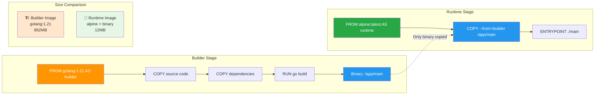
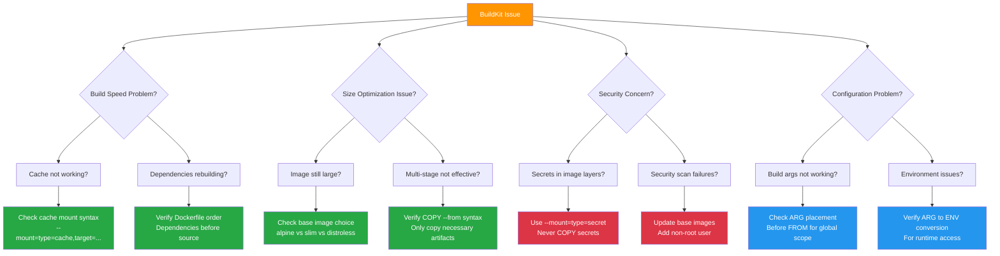

# Phase 02: BuildKit Advanced - Visual Specifications

> **Visual aids and diagrams for mastering advanced BuildKit features and multi-stage builds**

## 🎯 Visual Overview

Phase 02 requires sophisticated visuals to illustrate complex BuildKit concepts including multi-stage architecture, cache optimization flows, secret security boundaries, and build parameterization. These visuals must clarify advanced concepts that are difficult to understand through text alone.

## 🎨 Visual Style Guidelines

### Consistency with Previous Phases
- **Colors**: Docker blue (#2496ED), BuildKit green (#28A745), warning orange (#FF9500), danger red (#DC3545)
- **Typography**: Clear, readable fonts optimized for technical diagrams
- **Icons**: BuildKit-specific iconography, security badges, performance indicators
- **Layout**: Complex flows from left to right, multi-level hierarchies

### Phase 02 Specific Elements
- **Stage Separation**: Clear visual boundaries between build stages
- **Cache Indicators**: Speed/time symbols for cache hits/misses
- **Security Boundaries**: Lock icons, red barriers for secret isolation
- **Build Flows**: Branching diagrams for conditional builds

---

## 📊 Visual 1: Multi-Stage Build Architecture Flow

**Title**: Multi-Stage Build: Builder to Runtime Separation  
**Purpose**: Show how multi-stage builds eliminate build tools from production images  
**Type**: Mermaid flowchart with stage separation  
**Placement**: README.md, "Multi-Stage Builds" section

### Mermaid Code


### Implementation Details
- **Stage boundaries**: Clear visual separation with subgraphs
- **Copy flow**: Dotted arrow showing selective artifact transfer
- **Size comparison**: Side metrics showing dramatic size reduction
- **Color coding**: Orange for build, green for runtime, blue for artifacts

### Alt-text
"Multi-stage build flowchart showing builder stage with Go compiler (862MB) creating binary, then runtime stage with Alpine (12MB) copying only the binary. Demonstrates 98% size reduction from multi-stage architecture."

---

## 📊 Visual 2: Cache Mount Performance Optimization

**Title**: Build Cache: Performance Impact Visualization  
**Purpose**: Illustrate cache mount speed improvements and persistence  
**Type**: Before/After performance diagram (PNG)  
**Placement**: README.md and lab.md Lab 2 section

### Rough Sketch
```
WITHOUT CACHE MOUNTS                    WITH CACHE MOUNTS
┌─────────────────────┐                ┌─────────────────────┐
│ First Build         │                │ First Build         │
│ ┌─────────────────┐ │                │ ┌─────────────────┐ │
│ │ npm install     │ │ 🐌 45s        │ │ npm install     │ │ 🐌 45s
│ │ Downloads all   │ │                │ │ Downloads +     │ │
│ │ packages        │ │                │ │ Caches packages │ │
│ └─────────────────┘ │                │ └─────────────────┘ │
└─────────────────────┘                └─────────────────────┘

┌─────────────────────┐                ┌─────────────────────┐
│ Second Build        │                │ Second Build        │
│ ┌─────────────────┐ │                │ ┌─────────────────┐ │
│ │ npm install     │ │ 🐌 45s        │ │ npm install     │ │ ⚡ 3s
│ │ Downloads all   │ │                │ │ Uses cached     │ │
│ │ packages AGAIN  │ │                │ │ packages        │ │
│ └─────────────────┘ │                │ └─────────────────┘ │
└─────────────────────┘                └─────────────────────┘

CACHE PERSISTENCE                       MOUNT SYNTAX
┌─────────────────────┐                ┌─────────────────────┐
│ Build 1: Download   │ ❌ Disappears  │ --mount=type=cache, │
│ Build 2: Download   │ ❌ Disappears  │ target=/root/.npm   │
│ Build 3: Download   │ ❌ Disappears  │ ✅ Persistent       │
└─────────────────────┘                └─────────────────────┘

Performance: 15x slower                  Performance: 15x faster
Total Time: 90s                         Total Time: 48s
```

### Implementation Details
- **Timeline comparison**: Side-by-side build sequences
- **Speed indicators**: Emoji and timing for visual impact  
- **Cache persistence**: Show accumulative benefit
- **Syntax highlighting**: Code example with proper formatting

### Alt-text
"Performance comparison showing build without cache mounts taking 45 seconds each time versus cache mounts reducing subsequent builds to 3 seconds. Includes visual representation of cache persistence and mount syntax."

---

## 📊 Visual 3: Build Secrets Security Architecture

**Title**: Zero-Leakage Secret Handling in BuildKit  
**Purpose**: Show secret isolation and security boundaries during build  
**Type**: Security architecture diagram (PNG)  
**Placement**: README.md and lab.md Lab 3 section

### Rough Sketch
```
TRADITIONAL APPROACH (INSECURE)
┌─────────────────────────────────────────────────────────┐
│ Build Context                                           │
│ ┌─────────────┐    ┌─────────────┐    ┌─────────────┐   │
│ │ COPY .env   │ -> │ RUN command │ -> │ RUN rm .env │   │
│ │ 🔑 SECRET   │    │ uses secret │    │ 🚫 TOO LATE │   │
│ └─────────────┘    └─────────────┘    └─────────────┘   │
│              Layer 1         Layer 2        Layer 3     │
└─────────────────────────────────────────────────────────┘
                              ❌ Secret in Layer 1 forever

BUILDKIT SECRETS (SECURE)
┌─────────────────────────────────────────────────────────┐
│ Secret Mount System                                     │
│                                                         │
│ ┌─────────────┐    ┌─────────────┐    ┌─────────────┐   │
│ │ Host Secret │    │ Mount Point │    │ Build Layer │   │
│ │ 🔒 api.key  │~~~>│/run/secrets/│~~~>│ RUN command │   │
│ │ EXTERNAL    │    │ 📁 temp     │    │ uses secret │   │
│ └─────────────┘    └─────────────┘    └─────────────┘   │
│                                                         │
│ ┌─────────────────────────────────────────────────────┐ │
│ │ Security Boundary                                   │ │
│ │ ✅ No secret in any image layer                    │ │
│ │ ✅ No secret in image history                      │ │
│ │ ✅ Temporary access during RUN only                │ │
│ │ ✅ Automatic cleanup after instruction             │ │
│ └─────────────────────────────────────────────────────┘ │
└─────────────────────────────────────────────────────────┘

SYNTAX COMPARISON
┌─────────────────────┐         ┌─────────────────────┐
│ ❌ INSECURE         │         │ ✅ SECURE           │
│                     │         │                     │
│ COPY secret.key .   │         │ RUN --mount=type=   │
│ RUN use-secret      │   VS    │     secret,id=key   │
│ RUN rm secret.key   │         │   use-secret        │
│                     │         │                     │
│ Secret in layer!    │         │ Zero leakage!       │
└─────────────────────┘         └─────────────────────┘
```

### Implementation Details
- **Security boundaries**: Clear red barriers around insecure sections
- **Data flow**: Arrows showing secret movement and access
- **Layer visualization**: Show how secrets persist in traditional approach
- **Syntax comparison**: Side-by-side secure vs insecure examples

### Alt-text
"Security architecture diagram comparing traditional secret handling (insecure) where secrets persist in image layers, versus BuildKit secret mounts providing zero-leakage temporary access during build without layer persistence."

---

## 📊 Visual 4: Build Arguments Configuration Matrix

**Title**: Build Arguments: Flexibility and Configuration Scenarios  
**Purpose**: Show how build arguments enable multiple deployment configurations  
**Type**: Configuration matrix with examples (PNG)  
**Placement**: README.md and lab.md Lab 4 section

### Matrix Layout
```
BUILD ARGUMENT SCENARIOS
┌─────────────────────────────────────────────────────────────────────────────┐
│                    DEVELOPMENT         STAGING           PRODUCTION         │
├─────────────────────────────────────────────────────────────────────────────┤
│ APP_ENV           │ development        │ staging          │ production       │
│ DEBUG_MODE        │ true              │ true             │ false            │
│ APP_VERSION       │ latest            │ v1.2.0-rc1       │ v1.2.0           │
│ FEATURE_FLAGS     │ all               │ beta             │ stable           │
│ BASE_IMAGE        │ node:18           │ node:18-alpine   │ node:18-alpine   │
│ INSTALL_DEV_TOOLS │ true              │ false            │ false            │
├─────────────────────────────────────────────────────────────────────────────┤
│ Build Command:    │                   │                  │                  │
│ docker build      │ docker build      │ docker build     │ docker build     │
│   --build-arg     │   --build-arg     │   --build-arg    │   --build-arg    │
│   APP_ENV=dev     │   APP_ENV=staging │   APP_ENV=prod   │   DEBUG_MODE=false│
│   -t app:dev .    │   -t app:staging  │   -t app:prod    │   -t app:prod .  │
└─────────────────────────────────────────────────────────────────────────────┘

ARGUMENT FLOW IN DOCKERFILE
┌─────────────────────────────────────────────────────────────────────────────┐
│ ARG APP_ENV=development          ←── Default value provided               │
│ ARG DEBUG_MODE=true              ←── Boolean argument                     │
│ ARG FEATURE_FLAGS="basic"        ←── String argument with default         │
│                                                                            │
│ FROM node:18-alpine                                                        │
│                                                                            │
│ # Argument validation                                                      │
│ RUN if [ "$APP_ENV" != "development" ] && \                               │
│        [ "$APP_ENV" != "staging" ] && \                                   │
│        [ "$APP_ENV" != "production" ]; then \                             │
│         echo "Invalid APP_ENV: $APP_ENV" && exit 1; \                     │
│     fi                                                                     │
│                                                                            │
│ # Convert to ENV for runtime                                              │
│ ENV APP_ENVIRONMENT=$APP_ENV      ←── Runtime access                      │
│ ENV DEBUG=$DEBUG_MODE             ←── Runtime configuration               │
│ ENV FEATURES=$FEATURE_FLAGS       ←── Runtime feature control             │
│                                                                            │
│ # Conditional operations based on arguments                               │
│ RUN if [ "$DEBUG_MODE" = "true" ]; then \                                 │
│         npm install --include=dev; \                                      │
│     else \                                                                 │
│         npm install --only=production; \                                  │
│     fi                                                                     │
└─────────────────────────────────────────────────────────────────────────────┘

DECISION TREE
                Build Arguments Needed?
                        │
                       YES
                        │
            ┌───────────┴───────────┐
            │                       │
    Simple Override?         Complex Config?
            │                       │
           YES                     YES  
            │                       │
    Use ARG with default    Use ARG + validation
    Convert to ENV if       + conditional logic
    needed at runtime       + ENV conversion
```

### Implementation Details
- **Environment matrix**: Clear grid showing different configurations
- **Build commands**: Actual CLI examples for each scenario
- **Dockerfile flow**: Annotated code showing argument usage patterns
- **Decision tree**: Visual guide for choosing argument strategies

### Alt-text
"Build arguments configuration matrix showing development, staging, and production scenarios with different APP_ENV, DEBUG_MODE, and VERSION settings, including corresponding docker build commands and Dockerfile implementation patterns."

---

## 📊 Visual 5: BuildKit Advanced Features Integration

**Title**: Production BuildKit Architecture Overview  
**Purpose**: Show how all advanced features work together in production builds  
**Type**: Comprehensive system architecture diagram (PNG)  
**Placement**: README.md "Production Integration" section

### Architecture Layout
```
PRODUCTION BUILDKIT WORKFLOW
┌─────────────────────────────────────────────────────────────────────────────┐
│                           SOURCE CONTROL                                   │
│  ┌─────────────┐    ┌─────────────┐    ┌─────────────┐    ┌─────────────┐  │
│  │   Code      │    │ Dockerfile  │    │.dockerignore│    │Build Secrets│  │
│  │Repository   │    │Multi-stage  │    │Security     │    │External     │  │
│  └─────────────┘    └─────────────┘    └─────────────┘    └─────────────┘  │
└─────────────────────────────────────────────────────────────────────────────┘
             │                 │                 │                 │
             ▼                 ▼                 ▼                 ▼
┌─────────────────────────────────────────────────────────────────────────────┐
│                          BUILD ORCHESTRATION                               │
│                                                                             │
│  docker build \                                                             │
│    --build-arg APP_ENV=production \      ←── Build Arguments               │
│    --build-arg VERSION=v2.1.0 \                                           │
│    --secret id=api-key,src=./key \       ←── Secret Mounts                │
│    --target production \                  ←── Stage Selection              │
│    --cache-from type=registry \           ←── Cache Strategy               │
│    --cache-to type=registry .                                             │
└─────────────────────────────────────────────────────────────────────────────┘
             │
             ▼
┌─────────────────────────────────────────────────────────────────────────────┐
│                        MULTI-STAGE EXECUTION                               │
│                                                                             │
│  ┌─────────────────┐  ┌─────────────────┐  ┌─────────────────┐             │
│  │ BUILDER STAGE   │  │ TEST STAGE      │  │ RUNTIME STAGE   │             │
│  │                 │  │                 │  │                 │             │
│  │ FROM node:18    │  │ FROM builder    │  │ FROM alpine     │             │
│  │ Cache mounts:   │  │ RUN tests       │  │ COPY artifacts  │             │
│  │ ├─npm cache ✓   │  │ Linting ✓       │  │ Security setup  │             │
│  │ ├─pip cache ✓   │  │ Coverage ✓      │  │ Non-root user   │             │
│  │ Secret access:  │  │                 │  │                 │             │
│  │ ├─API keys 🔒   │  │                 │  │ Final: 25MB     │             │
│  │ Build: 800MB    │  │                 │  │                 │             │
│  └─────────────────┘  └─────────────────┘  └─────────────────┘             │
│         │                      │                      │                    │
│    Build artifacts        Test results          Production image           │
└─────────────────────────────────────────────────────────────────────────────┘
             │
             ▼
┌─────────────────────────────────────────────────────────────────────────────┐
│                          DEPLOYMENT PIPELINE                               │
│                                                                             │
│  ┌─────────────────┐  ┌─────────────────┐  ┌─────────────────┐             │
│  │   REGISTRY      │  │   KUBERNETES    │  │   MONITORING    │             │
│  │                 │  │                 │  │                 │             │
│  │ Image: 25MB     │  │ Deploy config   │  │ Health checks   │             │
│  │ Security scan ✓ │  │ Rolling update  │  │ Performance     │             │
│  │ Vulnerability   │  │ Resource limits │  │ Security alerts │             │
│  │ assessment ✓    │  │ Auto-scaling    │  │ Audit logging   │             │
│  └─────────────────┘  └─────────────────┘  └─────────────────┘             │
└─────────────────────────────────────────────────────────────────────────────┘

PERFORMANCE METRICS
┌─────────────────────────────────────────────────────────────────────────────┐
│                                                                             │
│  Without Advanced BuildKit    │  With Advanced BuildKit                    │
│  ──────────────────────────    │  ─────────────────────────                 │
│  Build Time: 8m 30s           │  Build Time: 1m 45s      ⚡ 80% faster    │
│  Image Size: 450MB            │  Image Size: 25MB         📦 94% smaller   │
│  Cache Reuse: 0%              │  Cache Reuse: 85%         🔄 Efficiency    │
│  Security: Secrets in layers  │  Security: Zero leakage   🔒 Secure        │
│  Flexibility: Single config   │  Flexibility: Multi-env   ⚙️  Configurable │
│                                                                             │
└─────────────────────────────────────────────────────────────────────────────┘
```

### Implementation Details
- **Workflow stages**: Clear progression from source to deployment
- **Integration points**: Show how features combine at each stage
- **Performance metrics**: Quantified benefits of advanced features
- **Real commands**: Actual docker build syntax with all flags

### Alt-text
"Comprehensive BuildKit production workflow showing integration of multi-stage builds, cache mounts, build secrets, and arguments from source control through deployment, with performance metrics showing 80% faster builds and 94% smaller images."

---

## 📊 Visual 6: Troubleshooting and Optimization Guide

**Title**: BuildKit Advanced: Common Issues and Solutions  
**Purpose**: Visual debugging guide for advanced BuildKit problems  
**Type**: Problem-solution flowchart (PNG)  
**Placement**: README.md "Production Considerations" section

### Troubleshooting Flowchart


### Implementation Details
- **Problem categories**: Group by type (performance, size, security, config)
- **Solution specificity**: Actionable fixes with syntax examples
- **Color coding**: Different colors for different concern types
- **Decision flow**: Clear yes/no decision points

### Alt-text
"Troubleshooting flowchart for BuildKit advanced features, categorizing problems into speed, size, security, and configuration issues with specific solutions for cache mounts, multi-stage builds, secrets handling, and build arguments."

---

## 🎨 Implementation Roadmap

### Phase 1: Core Architecture Visuals (Immediate)
1. **Multi-Stage Architecture** (Mermaid) - Shows fundamental separation concept
2. **Cache Performance** (PNG) - Critical for understanding speed benefits  
3. **Security Boundaries** (PNG) - Essential for secret handling comprehension

### Phase 2: Advanced Integration (Follow-up)
4. **Build Arguments Matrix** (PNG) - Configuration flexibility demonstration
5. **Production Architecture** (PNG) - Complete integration overview
6. **Troubleshooting Guide** (Mermaid) - Problem-solving reference

### Tools and Resources
- **Mermaid**: For system architecture and troubleshooting flows
- **Figma/Draw.io**: For complex security and performance diagrams
- **Carbon**: For syntax-highlighted code examples in visuals
- **Lucidchart**: For detailed production workflow diagrams

## 📏 Placement Strategy

### README.md Integration
- **Multi-stage architecture**: Core "Multi-Stage Builds" section
- **Production integration**: "Production Considerations" conclusion
- **Troubleshooting guide**: Problem-solving reference section

### lab.md Integration
- **Cache performance**: Lab 2 motivation and results
- **Security boundaries**: Lab 3 security concept introduction
- **Build arguments matrix**: Lab 4 configuration scenarios

### Responsive Considerations
- **Complex diagrams**: Ensure readability at mobile sizes
- **Information density**: Balance detail with clarity
- **Interactive elements**: Consider hover states for additional info

## 📋 Quality Checklist

For each visual:
- [ ] Clear learning objective aligned with Phase 02 advanced concepts
- [ ] Consistent BuildKit visual vocabulary and color scheme
- [ ] Readable at minimum 600px width with mobile considerations
- [ ] Comprehensive alt-text for accessibility compliance
- [ ] Enhances rather than duplicates complex text concepts
- [ ] Tested across different platforms and browsers
- [ ] Shows quantified benefits (performance, size, security metrics)

## 🔍 Success Metrics

Visuals should help learners:
- [ ] Understand multi-stage build architecture and separation benefits
- [ ] Predict cache mount performance improvements and optimization strategies
- [ ] Recognize security boundaries and zero-leakage secret handling
- [ ] Design flexible, parameterized builds for multiple environments
- [ ] Integrate all advanced BuildKit features in production workflows
- [ ] Troubleshoot common advanced BuildKit issues independently

## 🚀 Advanced Visualization Concepts

### Interactive Features (Future Enhancement)
- **Build time simulators**: Interactive cache hit/miss scenarios
- **Security boundary testing**: Click-through secret leak detection
- **Configuration generators**: Build argument scenario builders

### Animation Concepts
- **Cache fill progression**: Show cache building over multiple builds
- **Secret lifecycle**: Animated secret mount and cleanup
- **Multi-stage flow**: Progressive stage execution visualization

---

> 💡 **Implementation Note**: Focus on production-ready visual concepts that help learners understand complex BuildKit interactions. All visuals should emphasize practical benefits with quantified metrics and real-world scenarios. Store all visuals in `/visuals/phase-02/` with descriptive filenames following the pattern `p02-concept-description.png`.