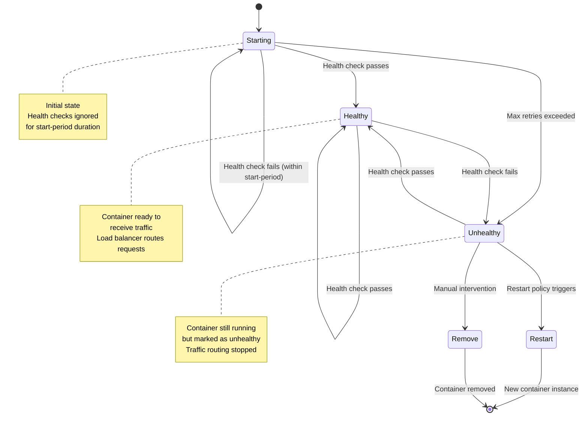
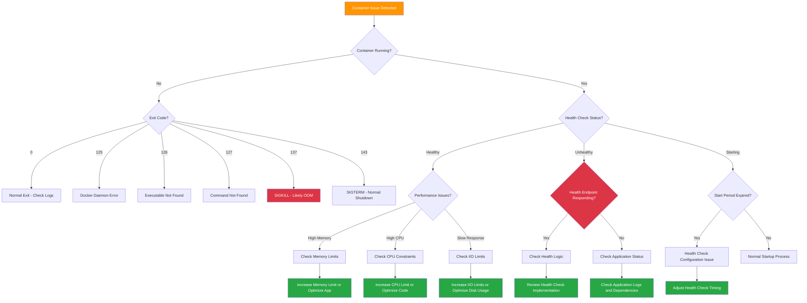

# Phase 03: Container Operations - Visual Specifications

> **Visual aids and diagrams for mastering container lifecycle management and production operations**

## 🎯 Visual Overview

Phase 03 requires comprehensive visuals to illustrate container operational concepts including health monitoring flows, restart policy decision trees, resource constraint impacts, and signal handling sequences. These visuals must clarify operational patterns essential for production container management.

## 🎨 Visual Style Guidelines

### Consistency with Previous Phases
- **Colors**: Docker blue (#2496ED), healthy green (#28A745), warning orange (#FF9500), critical red (#DC3545)
- **Typography**: Clear, readable fonts optimized for operational diagrams
- **Icons**: Container lifecycle symbols, monitoring indicators, resource gauges
- **Layout**: Process flows, decision trees, and system state diagrams

### Phase 03 Specific Elements
- **Health States**: Color-coded health status indicators (starting, healthy, unhealthy)
- **Restart Cycles**: Circular flow diagrams showing restart behaviors
- **Resource Meters**: Visual gauges for memory, CPU, and I/O usage
- **Signal Flows**: Timeline diagrams showing signal propagation and handling

---

## 📊 Visual 1: Container Health Check Lifecycle

**Title**: Container Health Check: States and Transitions  
**Purpose**: Show complete health check lifecycle from startup to failure recovery  
**Type**: State diagram with transition flows  
**Placement**: README.md, "Health Check Strategy" section

### Mermaid Code


### Implementation Details
- **State colors**: Starting (yellow), Healthy (green), Unhealthy (red)
- **Transition labels**: Clear conditions for each state change
- **Annotations**: Explain behavior at each state
- **Decision points**: Show when restart policies activate

### Alt-text
"State diagram showing container health check lifecycle with transitions between starting, healthy, and unhealthy states, including restart policy triggers and load balancer integration points."

---

## 📊 Visual 2: Restart Policy Decision Matrix

**Title**: Restart Policy Selection Guide  
**Purpose**: Help choose appropriate restart policy based on service type and requirements  
**Type**: Decision tree with policy comparison matrix (PNG)  
**Placement**: README.md and lab.md Lab 2 section

### Decision Tree Layout
```
Container Restart Policy Selection

START: What type of service is this?

┌─────────────────┐
│ Service Type?   │
└─────────────────┘
         │
    ┌────┴────┐
    │         │
    ▼         ▼
┌─────────┐ ┌─────────┐
│Web App  │ │Batch Job│
│Database │ │Worker   │  
│Cache    │ │Script   │
└─────────┘ └─────────┘
    │         │
    ▼         ▼
┌─────────────┐ ┌─────────────┐
│Should auto  │ │Should retry │
│recover from │ │on failure?  │
│any failure? │ └─────────────┘
└─────────────┘       │
    │            ┌────┴────┐
┌───┴───┐       │         │
│  YES  │       ▼         ▼
└───────┘   ┌───────┐ ┌───────┐
    │       │  YES  │ │  NO   │
    ▼       └───────┘ └───────┘
┌─────────────┐   │       │
│Manual stop  │   ▼       ▼
│should pause │ ┌─────┐ ┌─────┐
│auto restart?│ │on-  │ │ no  │
└─────────────┘ │fail │ └─────┘
    │           └─────┘
┌───┴───┐
│  YES  │
└───────┘
    │
    ▼
┌─────────────┐
│unless-stopped│
└─────────────┘

POLICY MATRIX:
┌──────────────┬─────────┬────────────┬─────────────┬────────────┐
│ Service Type │   no    │   always   │ on-failure  │unless-stop │
├──────────────┼─────────┼────────────┼─────────────┼────────────┤
│ Development  │   ✓     │     ×      │      ×      │     ×      │
│ Web Service  │   ×     │     ×      │      ×      │     ✓      │
│ Database     │   ×     │     ×      │      ×      │     ✓      │
│ Batch Job    │   ×     │     ×      │      ✓      │     ×      │
│ One-time     │   ✓     │     ×      │      ×      │     ×      │
│ System Svc   │   ×     │     ✓      │      ×      │     ×      │
└──────────────┴─────────┴────────────┴─────────────┴────────────┘

BEHAVIOR COMPARISON:
Exit Code 0 (success):   [no: stop] [always: restart] [on-failure: stop] [unless-stopped: stop]
Exit Code 1 (failure):   [no: stop] [always: restart] [on-failure: restart] [unless-stopped: restart]  
Manual Stop:              [no: stop] [always: restart] [on-failure: stop] [unless-stopped: stop]
Docker Restart:           [no: stop] [always: restart] [on-failure: restart] [unless-stopped: restart]
```

### Implementation Details
- **Decision flow**: Clear path from service type to policy choice
- **Matrix comparison**: Visual grid showing policy vs service type
- **Behavior examples**: Concrete scenarios for each policy
- **Color coding**: Green for recommended, red for not recommended

### Alt-text
"Decision tree and matrix showing restart policy selection based on service type, with behavioral comparison showing how each policy responds to different exit conditions and manual interventions."

---

## 📊 Visual 3: Resource Constraint Impact Visualization

**Title**: Resource Limits: Performance and Behavior Impact  
**Purpose**: Show how memory, CPU, and I/O constraints affect container performance  
**Type**: Multi-panel performance impact diagram (PNG)  
**Placement**: README.md and lab.md Lab 3 section

### Layout Design
```
RESOURCE CONSTRAINT IMPACT ANALYSIS

MEMORY LIMITS
┌─────────────────────────────────────────────────────────┐
│ Container Memory Usage Over Time                        │
│                                                         │
│ Memory │ ▲                                              │
│ (MB)   │ │     ┌─ OOM Kill Point                        │
│  512   │ ├─────┤                                        │
│        │ │     │  Application                           │
│  400   │ │   ┌─┴──┐ Terminated                          │
│        │ │  ╱    │                                      │
│  300   │ │ ╱     │                                      │
│        │ │╱      │                                      │
│  200   │ ┤       │                                      │  
│        │ │       │                                      │
│  100   │ │       └─ Container Restart                   │
│        │ │                                              │
│    0   │ └─────────────────────────────────────► Time  │
│        │ Start  Load   Peak   Kill  Restart             │
└─────────────────────────────────────────────────────────┘

Without Limit: [████████████████████████] 800MB (No Protection)
With Limit:    [██████████] 512MB (Protected, but may kill)
Optimal:       [████████] 400MB (Safe headroom)

CPU LIMITS
┌─────────────────────────────────────────────────────────┐
│ CPU Usage Comparison                                    │
│                                                         │
│ CPU %  │ ▲                                              │
│  100   │ ├─ Unlimited ──────────────────                │
│        │ │                                              │
│   80   │ ├─ Limited (2.0 CPUs) ─────────                │
│        │ │                                              │
│   50   │ ├─ Limited (0.5 CPUs) ───                      │
│        │ │                                              │
│   25   │ ├─ Throttled ──                                │
│        │ │                                              │
│    0   │ └─────────────────────────────────────► Time  │
│        │ Start    Ramp-up    Sustained Load             │
└─────────────────────────────────────────────────────────┘

Performance Impact:
Unlimited:     ████████████ 100% performance (may starve others)
2.0 CPUs:      ██████████   80% performance (balanced)
0.5 CPUs:      █████        50% performance (acceptable)
Throttled:     ██           20% performance (degraded)

I/O LIMITS
┌─────────────────────────────────────────────────────────┐
│ Disk I/O Throughput                                     │
│                                                         │
│ MB/s   │ ▲                                              │
│  100   │ ├─ No Limit ────────────                       │
│        │ │                                              │
│   50   │ ├─ Limited (50MB/s) ────                       │
│        │ │                                              │
│   25   │ ├─ Limited (25MB/s) ──                         │
│        │ │                                              │
│   10   │ ├─ Severely Limited ─                          │
│        │ │                                              │
│    0   │ └─────────────────────────────────────► Time  │
│        │ Start  Write Phase  Read Phase                 │
└─────────────────────────────────────────────────────────┘

Application Response Time Impact:
No I/O Limit:     ███ 100ms avg response
50MB/s Limit:     ███████ 200ms avg response  
25MB/s Limit:     ████████████ 400ms avg response
10MB/s Limit:     ████████████████████ 800ms avg response

RESOURCE MONITORING DASHBOARD
┌─────────────────────────────────────────────────────────┐
│ Container: web-service                                  │
│ ┌─────────────┐ ┌─────────────┐ ┌─────────────┐        │
│ │   Memory    │ │     CPU     │ │    Disk I/O │        │
│ │ ████████▒▒▒ │ │ ██████▒▒▒▒▒ │ │ ███▒▒▒▒▒▒▒▒ │       │
│ │  80% used   │ │  60% used   │ │  30% used   │        │
│ │  400/512 MB │ │  1.2/2.0 CPU│ │  15/50 MB/s │        │
│ └─────────────┘ └─────────────┘ └─────────────┘        │
│                                                         │
│ ⚠️  Alerts:                                             │
│ • Memory usage trending up                              │
│ • CPU bursts detected                                   │
│ ✅ I/O within normal limits                             │
└─────────────────────────────────────────────────────────┘
```

### Implementation Details
- **Multi-panel layout**: Separate sections for memory, CPU, and I/O
- **Performance graphs**: Time-series showing resource usage patterns
- **Impact metrics**: Quantified performance degradation
- **Monitoring dashboard**: Real-world monitoring interface example

### Alt-text
"Multi-panel diagram showing resource constraint impacts on container performance, including memory OOM scenarios, CPU throttling effects, I/O limit impacts, and integrated monitoring dashboard view."

---

## 📊 Visual 4: Signal Handling and Graceful Shutdown Flow

**Title**: Container Signal Handling: From SIGTERM to Cleanup  
**Purpose**: Illustrate proper signal handling sequence and graceful shutdown process  
**Type**: Timeline sequence diagram (PNG)  
**Placement**: README.md and lab.md Lab 4 section

### Sequence Diagram
```
CONTAINER GRACEFUL SHUTDOWN SEQUENCE

Timeline: docker stop my-container

Time │ Docker Daemon          │ Container (PID 1)        │ Application
─────┼─────────────────────────┼──────────────────────────┼─────────────────────
 0s  │ Receives stop request   │                          │ Normal operation
     │                        │                          │ Processing requests
─────┼─────────────────────────┼──────────────────────────┼─────────────────────
 1s  │ Sends SIGTERM to PID 1  │ ◄─ SIGTERM received     │ 
     │                        │    Signal handler fired  │ Signal handler activated
     │                        │                          │ Stop accepting new requests
─────┼─────────────────────────┼──────────────────────────┼─────────────────────
 2s  │ Waits for graceful exit │                          │ Finishing active requests
     │                        │                          │ Closing database connections
     │                        │                          │ Flushing logs
─────┼─────────────────────────┼──────────────────────────┼─────────────────────
 5s  │ Still waiting...        │                          │ Cleanup operations
     │                        │                          │ Saving state
     │                        │                          │ Releasing resources
─────┼─────────────────────────┼──────────────────────────┼─────────────────────
 8s  │ Still waiting...        │                          │ Final cleanup
     │                        │                          │ Close file handles
─────┼─────────────────────────┼──────────────────────────┼─────────────────────
 10s │ Grace period expired    │ Process exits cleanly    │ exit(0)
     │ Container stopped       │ Container state: exited  │ 
─────┼─────────────────────────┼──────────────────────────┼─────────────────────

FORCE KILL SCENARIO (if graceful fails):

Time │ Docker Daemon          │ Container (PID 1)        │ Application
─────┼─────────────────────────┼──────────────────────────┼─────────────────────
 0s  │ Receives stop request   │                          │ Normal operation
─────┼─────────────────────────┼──────────────────────────┼─────────────────────  
 1s  │ Sends SIGTERM to PID 1  │ ◄─ SIGTERM received     │ Signal handler activated
─────┼─────────────────────────┼──────────────────────────┼─────────────────────
10s  │ Grace period expired    │ Still running...         │ Cleanup in progress
─────┼─────────────────────────┼──────────────────────────┼─────────────────────
11s  │ Sends SIGKILL to PID 1  │ ◄─ SIGKILL received     │ ☠️  IMMEDIATE TERMINATION
     │                        │    Process terminated    │ (No cleanup possible)
     │ Container stopped       │    Container state:      │ 
     │                        │    exited (killed)       │
─────┼─────────────────────────┼──────────────────────────┼─────────────────────

SIGNAL HANDLING BEST PRACTICES

┌─────────────────────────────────────────────────────────────────┐
│ Dockerfile Signal Handling                                      │
│                                                                 │
│ ❌ Shell Form (signals not handled properly):                   │
│    CMD python app.py                                           │
│                                                                 │
│ ✅ Exec Form (signals handled correctly):                       │
│    CMD ["python", "app.py"]                                    │
│                                                                 │
│ ✅ With Signal Handling:                                        │
│    COPY signal-handler.py /app/                                │
│    CMD ["python", "signal-handler.py"]                         │
└─────────────────────────────────────────────────────────────────┘

┌─────────────────────────────────────────────────────────────────┐
│ Application Signal Handler Implementation                       │
│                                                                 │
│ import signal                                                   │
│ import sys                                                      │
│                                                                 │
│ def signal_handler(signum, frame):                             │
│     print("Received SIGTERM - starting graceful shutdown")     │
│     # 1. Stop accepting new requests                           │
│     # 2. Complete current requests                             │
│     # 3. Close database connections                            │
│     # 4. Flush logs and cleanup                                │
│     # 5. Exit cleanly                                          │
│     sys.exit(0)                                                │
│                                                                 │
│ signal.signal(signal.SIGTERM, signal_handler)                  │
└─────────────────────────────────────────────────────────────────┘

GRACEFUL SHUTDOWN CHECKLIST
┌─── Stop accepting new work
├─── Complete in-progress operations  
├─── Close database connections
├─── Flush logs and buffers
├─── Release file handles
├─── Save critical state
└─── Exit with status code 0
```

### Implementation Details
- **Timeline format**: Clear chronological sequence of events
- **Multi-actor view**: Docker daemon, container, and application perspectives
- **Best practices**: Dockerfile and code examples
- **Failure scenarios**: What happens when graceful shutdown fails

### Alt-text
"Timeline sequence diagram showing container graceful shutdown process from SIGTERM signal through cleanup operations, including force kill scenarios and signal handling best practices."

---

## 📊 Visual 5: Container Operations Production Workflow

**Title**: Production Container Operations: Monitoring and Management Integration  
**Purpose**: Show how all container operations integrate in production environment  
**Type**: System architecture workflow diagram (PNG)  
**Placement**: README.md "Production Considerations" section

### Architecture Layout
```
PRODUCTION CONTAINER OPERATIONS WORKFLOW

┌─────────────────────────────────────────────────────────────────────────────┐
│                            ORCHESTRATION LAYER                             │
│  ┌─────────────────┐    ┌─────────────────┐    ┌─────────────────┐         │
│  │   Kubernetes    │    │  Docker Swarm   │    │   Nomad/ECS     │         │
│  │                 │    │                 │    │                 │         │
│  │ • Health Checks │    │ • Health Checks │    │ • Health Checks │         │
│  │ • Restart Pol.  │    │ • Restart Pol.  │    │ • Restart Pol.  │         │
│  │ • Resource Mgmt │    │ • Resource Mgmt │    │ • Resource Mgmt │         │
│  │ • Rolling Updates│    │ • Rolling Updates│   │ • Rolling Updates│        │
│  └─────────────────┘    └─────────────────┘    └─────────────────┘         │
└─────────────────────────────────────────────────────────────────────────────┘
                                    │
                                    ▼
┌─────────────────────────────────────────────────────────────────────────────┐
│                         CONTAINER OPERATIONS LAYER                         │
│                                                                             │
│  ┌─────────────────┐  ┌─────────────────┐  ┌─────────────────┐             │
│  │ HEALTH STRATEGY │  │ RESTART POLICY  │  │ RESOURCE LIMITS │             │
│  │                 │  │                 │  │                 │             │
│  │ HTTP: /health   │  │ unless-stopped  │  │ Memory: 512MB   │             │
│  │ Interval: 30s   │  │ Max retries: 3  │  │ CPU: 1.0 cores  │             │
│  │ Timeout: 5s     │  │ Backoff: exp    │  │ I/O: 50MB/s     │             │
│  │ Start: 60s      │  │                 │  │                 │             │
│  └─────────────────┘  └─────────────────┘  └─────────────────┘             │
│           │                     │                     │                    │
│           ▼                     ▼                     ▼                    │
│  ┌─────────────────────────────────────────────────────────────────────┐   │
│  │                    RUNNING CONTAINERS                               │   │
│  │                                                                     │   │
│  │  [web-1] ✅ healthy    [web-2] ✅ healthy    [web-3] ⚠️  starting    │   │
│  │  Memory: 345MB/512MB   Memory: 298MB/512MB   Memory: 45MB/512MB     │   │
│  │  CPU: 65%              CPU: 52%              CPU: 12%               │   │
│  │  Restart: 0            Restart: 1            Restart: 0             │   │
│  └─────────────────────────────────────────────────────────────────────┘   │
└─────────────────────────────────────────────────────────────────────────────┘
                                    │
                                    ▼
┌─────────────────────────────────────────────────────────────────────────────┐
│                          MONITORING & ALERTING                             │
│                                                                             │
│ ┌─────────────────┐  ┌─────────────────┐  ┌─────────────────┐              │
│ │   PROMETHEUS    │  │    GRAFANA      │  │   ALERTMANAGER  │              │
│ │                 │  │                 │  │                 │              │
│ │ • Container     │  │ • Dashboards    │  │ • Health Alerts │              │
│ │   Metrics       │  │ • Performance   │  │ • Resource      │              │
│ │ • Health Status │  │ • Health Trends │  │   Alerts        │              │
│ │ • Resource      │  │ • Alert Visual  │  │ • Restart       │              │
│ │   Usage         │  │                 │  │   Notifications │              │
│ └─────────────────┘  └─────────────────┘  └─────────────────┘              │
└─────────────────────────────────────────────────────────────────────────────┘
                                    │
                                    ▼
┌─────────────────────────────────────────────────────────────────────────────┐
│                           OPERATIONAL RESPONSES                            │
│                                                                             │
│  HEALTH CHECK FAILURES:                                                    │
│  ┌─ Unhealthy detected → Remove from load balancer → Restart container     │
│  └─ Health restored → Add to load balancer → Resume traffic               │
│                                                                             │
│  RESOURCE CONSTRAINTS:                                                     │
│  ┌─ Memory spike → Alert team → Scale horizontally → Adjust limits         │
│  └─ CPU throttling → Performance alert → Optimize code → Add resources     │
│                                                                             │
│  RESTART SCENARIOS:                                                        │
│  ┌─ Application crash → Automatic restart → Health check → Traffic resume  │
│  └─ Repeated failures → Alert escalation → Manual investigation           │
│                                                                             │
│  GRACEFUL DEPLOYMENTS:                                                     │
│  ┌─ Rolling update → Signal containers → Graceful shutdown → New version   │
│  └─ Blue/green deploy → Health validation → Traffic switch → Old cleanup   │
└─────────────────────────────────────────────────────────────────────────────┘

OPERATIONAL METRICS DASHBOARD
┌─────────────────────────────────────────────────────────────────────────────┐
│ Service: web-application                    Time: Last 24h                 │
├─────────────────────────────────────────────────────────────────────────────┤
│                                                                             │
│ HEALTH METRICS                   │ RESTART METRICS                         │
│ ├─ Health Check Success: 99.2%   │ ├─ Total Restarts: 3                   │
│ ├─ Avg Response Time: 145ms      │ ├─ Restart Reason:                      │
│ ├─ Failed Health Checks: 12      │ │   └─ OOM Kill: 1                      │
│ └─ Recovery Time: 45s avg        │ │   └─ Exit Code 1: 2                   │
│                                  │ └─ Restart Success Rate: 100%          │
│                                                                             │
│ RESOURCE UTILIZATION             │ SIGNAL HANDLING                         │
│ ├─ Memory Peak: 487MB (95%)      │ ├─ SIGTERM Responses: 45                │
│ ├─ CPU Peak: 0.95 cores (95%)    │ ├─ Graceful Shutdowns: 44              │
│ ├─ I/O Peak: 45MB/s (90%)        │ ├─ Force Kills: 1                      │
│ └─ Resource Alerts: 2            │ └─ Avg Shutdown Time: 8s               │
│                                                                             │
│ 🚨 Active Alerts:                                                          │
│ • Memory usage trending upward (Warning)                                   │
│ • Restart frequency above threshold (Critical)                             │
└─────────────────────────────────────────────────────────────────────────────┘
```

### Implementation Details
- **Multi-layer architecture**: Shows integration from orchestration to monitoring
- **Real-world metrics**: Practical operational data and thresholds
- **Response workflows**: Automated and manual operational procedures
- **Dashboard mockup**: Realistic monitoring interface design

### Alt-text
"Production container operations workflow showing integration between orchestration layer, container operations, monitoring systems, and operational response procedures with real-time metrics dashboard."

---

## 📊 Visual 6: Container Operations Troubleshooting Guide

**Title**: Container Operations: Common Issues and Resolution Flow  
**Purpose**: Visual guide for diagnosing and resolving operational problems  
**Type**: Troubleshooting flowchart (PNG)  
**Placement**: README.md "Troubleshooting" section

### Troubleshooting Flowchart


### Implementation Details
- **Issue categorization**: Group by type (exit codes, health, performance)
- **Decision nodes**: Clear yes/no questions for diagnosis
- **Resolution actions**: Specific steps to fix identified problems
- **Color coding**: Problem severity and resolution type indication

### Alt-text
"Troubleshooting flowchart for container operations issues, categorizing problems by exit codes, health status, and performance metrics with specific resolution paths for each scenario."

---

## 🎨 Implementation Roadmap

### Phase 1: Essential Operational Visuals (Immediate)
1. **Health Check Lifecycle** (Mermaid) - Core operational concept
2. **Restart Policy Matrix** (PNG) - Critical decision support
3. **Signal Handling Flow** (PNG) - Essential for production deployments

### Phase 2: Advanced Operations (Follow-up)  
4. **Resource Constraint Impact** (PNG) - Performance optimization guide
5. **Production Workflow** (PNG) - Complete operational integration
6. **Troubleshooting Guide** (Mermaid) - Problem resolution reference

### Tools and Resources
- **Mermaid**: For process flows and state diagrams
- **Draw.io**: For complex operational architecture diagrams
- **Grafana/Prometheus**: For realistic monitoring dashboard screenshots
- **Figma**: For polished troubleshooting and decision matrices

## 📏 Placement Strategy

### README.md Integration
- **Health lifecycle**: Core "Health Check Strategy" section
- **Production workflow**: "Production Considerations" overview
- **Troubleshooting guide**: Problem-solving reference section

### lab.md Integration
- **Restart policy matrix**: Lab 2 policy selection guide
- **Resource impact**: Lab 3 constraint demonstration
- **Signal handling flow**: Lab 4 graceful shutdown concepts

### Responsive Considerations
- **Complex diagrams**: Ensure operational details remain readable
- **Decision trees**: Maintain usability on mobile devices
- **Performance charts**: Scale appropriately for different screen sizes

## 📋 Quality Checklist

For each visual:
- [ ] Clear operational learning objective aligned with production needs
- [ ] Consistent container operations visual vocabulary
- [ ] Readable on mobile devices with operational detail preserved
- [ ] Comprehensive alt-text for accessibility
- [ ] Enhances operational decision-making beyond text content
- [ ] Shows real-world operational scenarios and metrics
- [ ] Tested across different platforms and browsers

## 🔍 Success Metrics

Visuals should help learners:
- [ ] Understand container health check states and transitions
- [ ] Select appropriate restart policies for different service types
- [ ] Recognize resource constraint impacts on application performance
- [ ] Implement proper signal handling for graceful shutdowns
- [ ] Integrate container operations with monitoring and alerting systems
- [ ] Troubleshoot common container operational issues systematically

## 🚀 Advanced Visualization Concepts

### Interactive Features (Future Enhancement)
- **Health check simulator**: Interactive state transitions
- **Resource constraint calculator**: Dynamic limit recommendations
- **Signal handling tester**: Timeout and cleanup scenario modeling

### Animation Concepts
- **Health state transitions**: Animated health check lifecycle
- **Restart policy behaviors**: Dynamic restart scenarios
- **Resource usage patterns**: Time-series resource consumption visualization

---

> 💡 **Implementation Note**: Focus on operational excellence visuals that bridge development and production concerns. All diagrams should emphasize production reliability, monitoring integration, and operational decision-making. Store all visuals in `/visuals/phase-03/` with descriptive filenames following the pattern `p03-concept-description.png`.