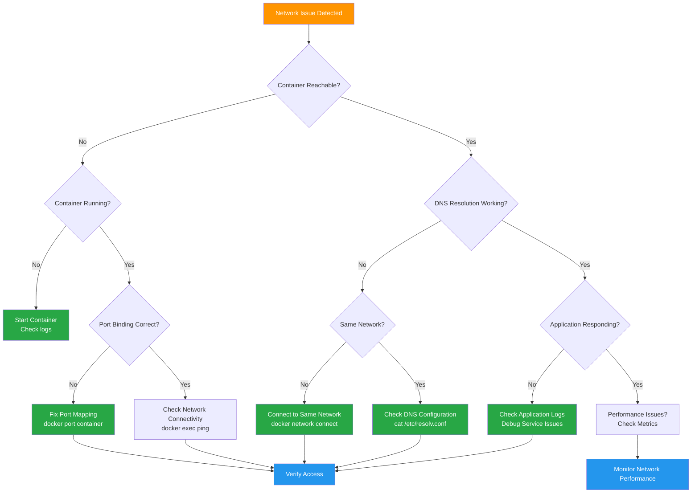

# Phase 04: Networking - Visual Specifications

> **Visual aids and diagrams for mastering Docker networking, service communication, and network architecture**

## 🎯 Visual Overview

Phase 04 requires comprehensive visuals to illustrate Docker networking concepts including network drivers, service discovery flows, isolation patterns, and port management strategies. These visuals must clarify complex networking concepts essential for production container deployments.

## 🎨 Visual Style Guidelines

### Consistency with Previous Phases
- **Colors**: Network blue (#2496ED), security red (#DC3545), isolation orange (#FF9500), success green (#28A745)
- **Typography**: Clear, readable fonts optimized for network diagrams
- **Icons**: Network topology symbols, container communication flows, port indicators
- **Layout**: Network topology maps, layered architecture diagrams

### Phase 04 Specific Elements
- **Network Segments**: Color-coded network boundaries and isolation
- **Communication Flows**: Directional arrows showing data paths
- **Port Mappings**: Visual port binding and exposure indicators
- **DNS Resolution**: Service discovery and name resolution flows

---

## 📊 Visual 1: Docker Network Drivers Comparison

**Title**: Network Driver Types: Architecture and Use Cases  
**Purpose**: Show different Docker network drivers and their networking behavior  
**Type**: Comparative architecture diagram (PNG)  
**Placement**: README.md, "Network Drivers" section

### Architecture Layout
```
DOCKER NETWORK DRIVER COMPARISON

┌─────────────────────────────────────────────────────────────────────────────┐
│                                HOST SYSTEM                                  │
│                                                                             │
│ ┌─────────────────────────────────────────────────────────────────────────┐ │
│ │                           BRIDGE NETWORK (Default)                     │ │
│ │                                                                         │ │
│ │  ┌───────────┐    ┌─────────────┐    ┌───────────┐                     │ │
│ │  │Container A│    │   docker0   │    │Container B│                     │ │
│ │  │  172.17.0.2│<──>│   bridge    │<──>│172.17.0.3 │                     │ │
│ │  │   :80     │    │             │    │   :8080   │                     │ │
│ │  └───────────┘    └─────────────┘    └───────────┘                     │ │
│ │                           │                                             │ │
│ │                           ▼                                             │ │
│ │  ┌─────────────────────────────────────────────────────────────────┐   │ │
│ │  │                    HOST NETWORK                               │   │ │
│ │  │                   eth0: 192.168.1.100                        │   │ │
│ │  └─────────────────────────────────────────────────────────────────┘   │ │
│ └─────────────────────────────────────────────────────────────────────────┘ │
│                                                                             │
│ ┌─────────────────────────────────────────────────────────────────────────┐ │
│ │                        CUSTOM BRIDGE NETWORK                           │ │
│ │                                                                         │ │
│ │  ┌───────────┐    ┌─────────────┐    ┌───────────┐                     │ │
│ │  │Web Server │    │   mybridge  │    │Database   │                     │ │
│ │  │172.20.0.2 │<──>│ 172.20.0.1  │<──>│172.20.0.3 │                     │ │
│ │  │   :80     │    │             │    │   :5432   │                     │ │
│ │  └───────────┘    └─────────────┘    └───────────┘                     │ │
│ │       ▲                                      ▲                         │ │
│ │       │ DNS: database                        │ DNS: webserver          │ │
│ │       └──────────────────────────────────────┘                         │ │
│ └─────────────────────────────────────────────────────────────────────────┘ │
│                                                                             │
│ ┌─────────────────────────────────────────────────────────────────────────┐ │
│ │                          HOST NETWORK MODE                             │ │
│ │                                                                         │ │
│ │  ┌───────────┐                                                         │ │
│ │  │Container  │    No network namespace isolation                       │ │
│ │  │Uses host  │    Direct access to host network interfaces             │ │
│ │  │network    │    Container processes bind directly to host ports      │ │
│ │  │directly   │    Performance: Highest (no NAT overhead)               │ │
│ │  └───────────┘    Security: Lowest (shared network stack)              │ │
│ └─────────────────────────────────────────────────────────────────────────┘ │
│                                                                             │
│ ┌─────────────────────────────────────────────────────────────────────────┐ │
│ │                           NONE NETWORK MODE                            │ │
│ │                                                                         │ │
│ │  ┌───────────┐                                                         │ │
│ │  │Container  │    Complete network isolation                           │ │
│ │  │Isolated   │    Only loopback interface (127.0.0.1)                  │ │
│ │  │   lo      │    No external connectivity                              │ │
│ │  │127.0.0.1  │    Use case: Security-sensitive processing              │ │
│ │  └───────────┘                                                         │ │
│ └─────────────────────────────────────────────────────────────────────────┘ │
└─────────────────────────────────────────────────────────────────────────────┘

DRIVER SELECTION MATRIX:
┌──────────────┬────────────┬──────────────┬─────────────┬──────────────┐
│   Driver     │    DNS     │  Isolation   │ Performance │   Use Case   │
├──────────────┼────────────┼──────────────┼─────────────┼──────────────┤
│ Bridge       │     No     │    Medium    │    Good     │  Single Host │
│ Custom Bridge│    Yes     │    High      │    Good     │  Recommended │
│ Host         │     -      │     None     │    Best     │ Performance  │
│ None         │     -      │   Complete   │     N/A     │   Security   │
│ Overlay      │    Yes     │    High      │    Good     │  Multi-Host  │
└──────────────┴────────────┴──────────────┴─────────────┴──────────────┘
```

### Implementation Details
- **Network boundaries**: Clear visual separation between network types
- **IP addressing**: Show actual IP ranges and addressing schemes  
- **DNS flows**: Indicate where DNS resolution works
- **Performance indicators**: Visual performance and security ratings

### Alt-text
"Docker network driver comparison showing bridge, custom bridge, host, and none network modes with their respective isolation, DNS capabilities, and performance characteristics in a layered architecture view."

---

## 📊 Visual 2: Service Discovery and DNS Resolution Flow

**Title**: Container Service Discovery: DNS Resolution Process  
**Purpose**: Illustrate how Docker DNS enables service discovery between containers  
**Type**: Sequence flow diagram (PNG)  
**Placement**: README.md and lab.md Lab 2 section

### Sequence Diagram
```
SERVICE DISCOVERY AND DNS RESOLUTION FLOW

Time │ Client Container        │ Docker DNS Server      │ Target Container
─────┼─────────────────────────┼─────────────────────────┼──────────────────
 1   │ Request: curl api-service│                        │
     │                        │                        │
 2   │ DNS Query: api-service  │ ◄─────────────────────  │
     │                        │                        │
 3   │                        │ Lookup network aliases │
     │                        │ Find containers:       │
     │                        │ - api-1: 172.20.0.2    │
     │                        │ - api-2: 172.20.0.3    │
     │                        │ - api-3: 172.20.0.4    │
     │                        │                        │
 4   │ DNS Response:           │ ──────────────────────► │
     │ 172.20.0.2              │                        │
     │ 172.20.0.3              │                        │ 
     │ 172.20.0.4              │                        │
     │                        │                        │
 5   │ TCP Connect: 172.20.0.2 │                        │ ◄─── HTTP Request
     │                        │                        │      (Round-robin)
 6   │                        │                        │ HTTP Response ───►
     │ ◄──────────────────────────────────────────────── │
─────┼─────────────────────────┼─────────────────────────┼──────────────────

DNS RESOLUTION SCOPE

NETWORK: frontend (172.20.0.0/24)
┌─────────────────────────────────────────────────────────────────┐
│  ┌───────────┐ DNS Query   ┌─────────────────────────────────┐   │
│  │  Web      │──────────────► │   Docker Embedded DNS       │   │
│  │Container  │              │   Scope: frontend network    │   │
│  │           │◄─────────────  │   Resolves: api-service     │   │
│  └───────────┘ DNS Response │   Returns: [172.20.0.2,      │   │
│                             │           172.20.0.3,        │   │
│                             │           172.20.0.4]        │   │
│                             └─────────────────────────────────┘   │
│                                                                 │
│  ┌───────────┐  ┌───────────┐  ┌───────────┐                   │
│  │  api-1    │  │   api-2   │  │   api-3   │                   │
│  │172.20.0.2 │  │172.20.0.3 │  │172.20.0.4 │                   │
│  │alias:     │  │alias:     │  │alias:     │                   │
│  │api-service│  │api-service│  │api-service│                   │
│  └───────────┘  └───────────┘  └───────────┘                   │
└─────────────────────────────────────────────────────────────────┘

NETWORK: backend (172.21.0.0/24)
┌─────────────────────────────────────────────────────────────────┐
│  Frontend containers CANNOT resolve backend services           │
│  DNS scope is limited to connected networks only               │
│  Cross-network communication requires network connections      │
└─────────────────────────────────────────────────────────────────┘

RESOLUTION TYPES:
┌─────────────────┬──────────────────────┬─────────────────────┐
│   Name Type     │      Resolves To     │     Use Case        │
├─────────────────┼──────────────────────┼─────────────────────┤
│ Container Name  │ Single IP address    │ Direct container    │
│ Network Alias   │ Multiple IP addresses│ Load balancing      │
│ Custom Hostname │ Single IP address    │ Service naming      │
│ External Domain │ External resolution  │ Internet services   │
└─────────────────┴──────────────────────┴─────────────────────┘
```

### Implementation Details
- **Timeline format**: Clear chronological sequence of DNS resolution
- **Network scoping**: Show DNS isolation between networks
- **Load balancing**: Illustrate round-robin DNS behavior
- **Resolution types**: Different name resolution patterns

### Alt-text
"Service discovery sequence diagram showing DNS resolution flow from client container through Docker's embedded DNS server to target containers, including network scoping and load balancing behavior."

---

## 📊 Visual 3: Network Isolation and Security Architecture

**Title**: Multi-Tier Network Security: Isolation and Access Control  
**Purpose**: Show network segmentation strategies for security  
**Type**: Security architecture diagram (PNG)  
**Placement**: README.md and lab.md Lab 3 section

### Security Architecture Layout
```
MULTI-TIER NETWORK SECURITY ARCHITECTURE

┌─────────────────────────────────────────────────────────────────────────────┐
│                              INTERNET                                      │
│                                 │                                           │
│                                 ▼                                           │
│ ┌─────────────────────────────────────────────────────────────────────────┐ │
│ │                          DMZ NETWORK                                   │ │
│ │                        172.30.0.0/24                                   │ │
│ │                                                                         │ │
│ │  ┌─────────────────┐    ┌─────────────────┐                           │ │
│ │  │  Load Balancer  │    │ Reverse Proxy   │                           │ │
│ │  │  172.30.0.10    │    │ 172.30.0.11     │                           │ │
│ │  │  Ports: 80,443  │    │ SSL Termination │                           │ │
│ │  └─────────────────┘    └─────────────────┘                           │ │
│ │          │                       │                                     │ │
│ │          └───────┬───────────────┘                                     │ │
│ │                  ▼                                                     │ │
│ └─────────────────────────────────────────────────────────────────────────┘ │
│                    │ Controlled Access                                     │
│                    ▼                                                       │
│ ┌─────────────────────────────────────────────────────────────────────────┐ │
│ │                       APPLICATION NETWORK                              │ │
│ │                         172.31.0.0/24                                  │ │
│ │                                                                         │ │
│ │  ┌─────────────────┐    ┌─────────────────┐    ┌─────────────────┐     │ │
│ │  │   Web Service   │    │   API Gateway   │    │  Auth Service   │     │ │
│ │  │  172.31.0.10    │    │  172.31.0.11    │    │  172.31.0.12    │     │ │
│ │  │   Port: 8080    │    │   Port: 3000    │    │   Port: 4000    │     │ │
│ │  └─────────────────┘    └─────────────────┘    └─────────────────┘     │ │
│ │          │                       │                       │             │ │
│ │          └───────────────────────┼───────────────────────┘             │ │
│ │                                  ▼                                     │ │
│ └─────────────────────────────────────────────────────────────────────────┘ │
│                                  │ Database Access Only                    │
│                                  ▼                                         │
│ ┌─────────────────────────────────────────────────────────────────────────┐ │
│ │                        DATABASE NETWORK                                │ │
│ │                         172.32.0.0/24                                  │ │
│ │                                                                         │ │
│ │  ┌─────────────────┐    ┌─────────────────┐    ┌─────────────────┐     │ │
│ │  │   PostgreSQL    │    │     Redis       │    │   Backup Svc    │     │ │
│ │  │  172.32.0.10    │    │  172.32.0.11    │    │  172.32.0.12    │     │ │
│ │  │   Port: 5432    │    │   Port: 6379    │    │   Port: 8080    │     │ │
│ │  └─────────────────┘    └─────────────────┘    └─────────────────┘     │ │
│ │                                                                         │ │
│ │  🔒 No external access • No inter-service communication                │ │
│ └─────────────────────────────────────────────────────────────────────────┘ │
│                                                                             │
│ ┌─────────────────────────────────────────────────────────────────────────┐ │
│ │                        MANAGEMENT NETWORK                              │ │
│ │                         172.33.0.0/24                                  │ │
│ │                                                                         │ │
│ │  ┌─────────────────┐    ┌─────────────────┐                           │ │
│ │  │   Monitoring    │    │     Logging     │                           │ │
│ │  │  172.33.0.10    │    │  172.33.0.11    │                           │ │
│ │  │  Port: 9090     │    │   Port: 5044    │                           │ │
│ │  └─────────────────┘    └─────────────────┘                           │ │
│ │          ▲                       ▲                                     │ │
│ │          └───────Cross-network connections for monitoring──────────────┘ │
│ └─────────────────────────────────────────────────────────────────────────┘ │
└─────────────────────────────────────────────────────────────────────────────┘

NETWORK ACCESS MATRIX:
┌────────────┬─────────┬─────────────┬──────────┬────────────┬──────────────┐
│   FROM     │   DMZ   │ APPLICATION │ DATABASE │ MANAGEMENT │   INTERNET   │
├────────────┼─────────┼─────────────┼──────────┼────────────┼──────────────┤
│ DMZ        │   ✓     │      ✓      │    ❌    │     ❌     │      ✓       │
│ Application│   ❌    │      ✓      │    ✓     │     ❌     │      ✓       │
│ Database   │   ❌    │      ❌     │    ✓     │     ❌     │      ❌       │
│ Management │   ✓     │      ✓      │    ✓     │     ✓     │      ✓       │
│ Internet   │   ✓     │      ❌     │    ❌    │     ❌     │      ✓       │
└────────────┴─────────┴─────────────┴──────────┴────────────┴──────────────┘

SECURITY CONTROLS:
• Network Segmentation: Physical isolation between tiers
• Access Control: Explicit network connections required
• Port Restriction: Only necessary ports exposed
• Traffic Flow: Unidirectional where possible
• Monitoring: All network activity logged and monitored
```

### Implementation Details
- **Tier separation**: Clear visual boundaries between security zones
- **Access flow**: Directional arrows showing allowed communication
- **Security indicators**: Lock icons and access control matrices
- **IP addressing**: Realistic subnet allocation for each tier

### Alt-text
"Multi-tier network security architecture showing DMZ, application, database, and management networks with controlled access flows and comprehensive security isolation between tiers."

---

## 📊 Visual 4: Port Management and External Access Patterns

**Title**: Container Port Management: Publishing and Security Strategies  
**Purpose**: Show different port publishing patterns and their security implications  
**Type**: Port management comparison diagram (PNG)  
**Placement**: README.md and lab.md Lab 4 section

### Port Management Layout
```
CONTAINER PORT MANAGEMENT STRATEGIES

┌─────────────────────────────────────────────────────────────────────────────┐
│                            HOST SYSTEM (192.168.1.100)                     │
│                                                                             │
│ ┌─────────────────────────────────────────────────────────────────────────┐ │
│ │                        STATIC PORT MAPPING                             │ │
│ │                                                                         │ │
│ │  Internet ──► 192.168.1.100:8080 ──► Container:80                      │ │
│ │                      ▲                     ▲                           │ │
│ │                      │                     │                           │ │
│ │               Host Port 8080        Container Port 80                   │ │
│ │               (Fixed mapping)       (Application port)                  │ │
│ │                                                                         │ │
│ │  Command: docker run -p 8080:80 nginx                                  │ │
│ │  Security: Predictable, easy to firewall                               │ │
│ │  Use Case: Production services, load balancers                         │ │
│ └─────────────────────────────────────────────────────────────────────────┘ │
│                                                                             │
│ ┌─────────────────────────────────────────────────────────────────────────┐ │
│ │                       DYNAMIC PORT ALLOCATION                          │ │
│ │                                                                         │ │
│ │  Internet ──► 192.168.1.100:32768 ──► Container:8080                   │ │
│ │                      ▲                      ▲                          │ │
│ │                      │                      │                          │ │
│ │            Docker-chosen port        Application port                   │ │
│ │            (Random high port)       (Exposed in Dockerfile)            │ │
│ │                                                                         │ │
│ │  Command: docker run -P myapp                                          │ │
│ │  Security: Unpredictable ports, harder to target                       │ │
│ │  Use Case: Development, temporary services                              │ │
│ └─────────────────────────────────────────────────────────────────────────┘ │
│                                                                             │
│ ┌─────────────────────────────────────────────────────────────────────────┐ │
│ │                     INTERFACE-SPECIFIC BINDING                         │ │
│ │                                                                         │ │
│ │  Internet ──✗──► 192.168.1.100:8080                                    │ │
│ │                        ▲ (Blocked)                                      │ │
│ │                        │                                                │ │
│ │  Localhost ──► 127.0.0.1:8080 ──► Container:80                         │ │
│ │                        ▲                    ▲                          │ │
│ │                        │                    │                          │ │
│ │               Local interface only   Application port                   │ │
│ │               (Security restriction) (Internal access)                  │ │
│ │                                                                         │ │
│ │  Command: docker run -p 127.0.0.1:8080:80 nginx                       │ │
│ │  Security: Local access only, no external exposure                     │ │
│ │  Use Case: Development databases, internal tools                        │ │
│ └─────────────────────────────────────────────────────────────────────────┘ │
│                                                                             │
│ ┌─────────────────────────────────────────────────────────────────────────┐ │
│ │                        PORT RANGE MAPPING                              │ │
│ │                                                                         │ │
│ │  Port 9000 ──► Container:9000 ┐                                        │ │
│ │  Port 9001 ──► Container:9001 ├── Bulk mapping                         │ │
│ │  Port 9002 ──► Container:9002 │   (Efficient for multiple ports)       │ │
│ │  Port 9003 ──► Container:9003 ┘                                        │ │
│ │                                                                         │ │
│ │  Command: docker run -p 9000-9003:9000-9003 multiport-app              │ │
│ │  Security: Multiple attack surfaces, needs careful management           │ │
│ │  Use Case: Gaming servers, development environments                     │ │
│ └─────────────────────────────────────────────────────────────────────────┘ │
└─────────────────────────────────────────────────────────────────────────────┘

LOAD BALANCER PATTERN
┌─────────────────────────────────────────────────────────────────────────────┐
│                         REVERSE PROXY ARCHITECTURE                         │
│                                                                             │
│         Internet                                                            │
│            │                                                                │
│            ▼                                                                │
│  ┌─────────────────┐                                                       │
│  │  Load Balancer  │ Port 80/443 (Public)                                 │
│  │  (nginx/traefik)│                                                       │
│  └─────────────────┘                                                       │
│            │                                                                │
│    ┌───────┼───────┐                                                       │
│    ▼       ▼       ▼                                                       │
│ ┌──────┐ ┌──────┐ ┌──────┐                                                 │
│ │App-1 │ │App-2 │ │App-3 │ No public ports                                │
│ │:8080 │ │:8080 │ │:8080 │ (Internal network only)                        │
│ └──────┘ └──────┘ └──────┘                                                 │
│                                                                             │
│ Benefits:                                                                   │
│ • Single point of entry (security)                                         │
│ • SSL termination centralized                                              │
│ • Load balancing and health checks                                         │
│ • Backend services not directly exposed                                    │
└─────────────────────────────────────────────────────────────────────────────┘

PORT SECURITY MATRIX:
┌─────────────────┬─────────────┬─────────────┬─────────────────┬─────────────┐
│  Mapping Type   │  Security   │ Flexibility │ Management      │  Use Case   │
├─────────────────┼─────────────┼─────────────┼─────────────────┼─────────────┤
│ Static Mapping  │   Medium    │     Low     │     Easy        │ Production  │
│ Dynamic Ports   │    High     │    High     │   Difficult     │ Development │
│ Interface Bind  │    High     │    Low      │     Easy        │ Local Only  │
│ No Port Mapping │   Highest   │    Medium   │     Medium      │ Internal    │
│ Port Ranges     │     Low     │    High     │   Difficult     │ Special Use │
└─────────────────┴─────────────┴─────────────┴─────────────────┴─────────────┘
```

### Implementation Details
- **Traffic flow**: Clear arrows showing request paths
- **Security levels**: Visual indicators for security implications
- **Port mapping**: Detailed port binding examples
- **Architecture patterns**: Real-world deployment scenarios

### Alt-text
"Container port management strategies showing static mapping, dynamic allocation, interface binding, and port ranges with security implications and load balancer architecture patterns for production deployments."

---

## 📊 Visual 5: Service Mesh and Advanced Networking

**Title**: Container Service Mesh: Advanced Communication Patterns  
**Purpose**: Show service mesh concepts and advanced networking architectures  
**Type**: Service mesh architecture diagram (PNG)  
**Placement**: README.md "Production Considerations" section

### Service Mesh Layout
```
SERVICE MESH ARCHITECTURE FOR MICROSERVICES

┌─────────────────────────────────────────────────────────────────────────────┐
│                            CONTROL PLANE                                   │
│                                                                             │
│  ┌─────────────────┐  ┌─────────────────┐  ┌─────────────────┐             │
│  │  Service Mesh   │  │   Certificate   │  │    Policy       │             │
│  │   Controller    │  │   Authority     │  │   Management    │             │
│  │                 │  │                 │  │                 │             │
│  └─────────────────┘  └─────────────────┘  └─────────────────┘             │
│           │                     │                     │                    │
│           └─────────────────────┼─────────────────────┘                    │
│                                 ▼                                          │
└─────────────────────────────────────────────────────────────────────────────┘
                                 │ Configuration & Policies
                                 ▼
┌─────────────────────────────────────────────────────────────────────────────┐
│                              DATA PLANE                                    │
│                                                                             │
│  ┌─────────────────────────────────────────────────────────────────────┐   │
│  │                         SERVICE A                                   │   │
│  │                                                                     │   │
│  │  ┌─────────────┐              ┌─────────────────────────────────┐   │   │
│  │  │ Application │              │         Sidecar Proxy           │   │   │
│  │  │  Container  │◄────────────►│       (Envoy/nginx)             │   │   │
│  │  │             │              │  • Traffic encryption          │   │   │
│  │  │   Port:     │              │  • Load balancing               │   │   │
│  │  │   8080      │              │  • Circuit breaking             │   │   │
│  │  └─────────────┘              │  • Metrics collection           │   │   │
│  └─────────────────────────────────────────────────────────────────────┘   │
│           │                               │                                │
│           │                               ▼                                │
│           │                    ┌─────────────────┐                        │
│           │                    │ Service B Proxy │                        │
│           │                    └─────────────────┘                        │
│           │                               │                                │
│           ▼                               ▼                                │
│  ┌─────────────────────────────────────────────────────────────────────┐   │
│  │                         SERVICE B                                   │   │
│  │                                                                     │   │
│  │  ┌─────────────┐              ┌─────────────────────────────────┐   │   │
│  │  │ Application │              │         Sidecar Proxy           │   │   │
│  │  │  Container  │◄────────────►│       (Envoy/nginx)             │   │   │
│  │  │             │              │  • mTLS authentication          │   │   │
│  │  │   Port:     │              │  • Request routing              │   │   │
│  │  │   9090      │              │  • Retry policies               │   │   │
│  │  └─────────────┘              │  • Observability                │   │   │
│  └─────────────────────────────────────────────────────────────────────┘   │
│           │                               │                                │
│           │                               ▼                                │
│           │                    ┌─────────────────┐                        │
│           │                    │ Database Proxy  │                        │
│           │                    └─────────────────┘                        │
│           │                               │                                │
│           ▼                               ▼                                │
│  ┌─────────────────────────────────────────────────────────────────────┐   │
│  │                       DATABASE                                      │   │
│  │                                                                     │   │
│  │  ┌─────────────┐              ┌─────────────────────────────────┐   │   │
│  │  │ PostgreSQL  │              │         Sidecar Proxy           │   │   │
│  │  │  Container  │◄────────────►│       (Database-aware)          │   │   │
│  │  │             │              │  • Connection pooling           │   │   │
│  │  │   Port:     │              │  • Query monitoring             │   │   │
│  │  │   5432      │              │  • Access control               │   │   │
│  │  └─────────────┘              │  • Audit logging                │   │   │
│  └─────────────────────────────────────────────────────────────────────┘   │
└─────────────────────────────────────────────────────────────────────────────┘

TRAFFIC FLOW WITH SECURITY:
┌─────────────────────────────────────────────────────────────────────────────┐
│ 1. Client Request ──► Service A Proxy ──► Service A Application            │
│                                                                             │
│ 2. Service A ──► Service B Proxy ──► Service B Application                 │
│    │                                                                        │
│    └─ mTLS Certificate Validation                                           │
│    └─ Policy Check (Authorization)                                          │
│    └─ Circuit Breaker Evaluation                                            │
│    └─ Load Balancing Decision                                               │
│                                                                             │
│ 3. Service B ──► Database Proxy ──► Database                               │
│    │                                                                        │
│    └─ Connection Pool Management                                            │
│    └─ Query Analysis & Logging                                              │
│    └─ Access Control Validation                                             │
│                                                                             │
│ 4. Response Path (Reverse of request)                                      │
│    Database ──► DB Proxy ──► Service B ──► Service B Proxy                │
│    Service B Proxy ──► Service A Proxy ──► Client                         │
└─────────────────────────────────────────────────────────────────────────────┘

SERVICE MESH BENEFITS:
┌─────────────────────────────────────────────────────────────────────────────┐
│ Security:                                                                   │
│ • Automatic mTLS between all services                                      │
│ • Fine-grained access policies                                             │
│ • Certificate rotation and management                                      │
│                                                                             │
│ Observability:                                                              │
│ • Distributed tracing across services                                      │
│ • Detailed metrics and monitoring                                          │
│ • Traffic visualization and analysis                                       │
│                                                                             │
│ Traffic Management:                                                         │
│ • Intelligent load balancing                                               │
│ • Circuit breakers and retries                                             │
│ • A/B testing and canary deployments                                       │
│                                                                             │
│ Operational:                                                                │
│ • Zero-code changes required                                               │
│ • Centralized policy management                                            │
│ • Platform-agnostic implementation                                         │
└─────────────────────────────────────────────────────────────────────────────┘
```

### Implementation Details
- **Control/Data plane separation**: Clear architectural boundaries
- **Sidecar pattern**: Show proxy integration with applications
- **Security flows**: mTLS and policy enforcement visualization
- **Traffic management**: Load balancing and resilience patterns

### Alt-text
"Service mesh architecture showing control plane policy management, data plane sidecar proxies, and secure inter-service communication with mTLS, load balancing, and observability features."

---

## 📊 Visual 6: Network Troubleshooting and Monitoring

**Title**: Docker Network Troubleshooting: Diagnostic Tools and Techniques  
**Purpose**: Visual guide for diagnosing and resolving network issues  
**Type**: Troubleshooting workflow diagram (PNG)  
**Placement**: README.md "Troubleshooting" section

### Troubleshooting Workflow


### Implementation Details
- **Decision tree**: Systematic approach to network troubleshooting
- **Diagnostic commands**: Specific tools and commands for each scenario
- **Resolution actions**: Clear next steps for each problem type
- **Color coding**: Problem types and resolution categories

### Alt-text
"Network troubleshooting flowchart showing systematic diagnosis of container connectivity issues with specific diagnostic commands and resolution steps for each scenario type."

---

## 🎨 Implementation Roadmap

### Phase 1: Core Networking Visuals (Immediate)
1. **Network Drivers Comparison** (PNG) - Foundation networking concepts
2. **Service Discovery Flow** (PNG) - Critical for microservices  
3. **Security Architecture** (PNG) - Essential for production deployments

### Phase 2: Advanced Patterns (Follow-up)
4. **Port Management** (PNG) - Security and access control
5. **Service Mesh Architecture** (PNG) - Advanced communication patterns
6. **Troubleshooting Workflow** (Mermaid) - Problem-solving reference

### Tools and Resources
- **Draw.io**: For complex network topology diagrams
- **Mermaid**: For troubleshooting flows and sequences
- **Figma**: For detailed security and port management diagrams
- **Network simulation tools**: For realistic networking scenarios

## 📏 Placement Strategy

### README.md Integration
- **Driver comparison**: Core "Network Drivers" section
- **Service mesh**: "Production Considerations" advanced patterns
- **Troubleshooting**: Problem-solving reference section

### lab.md Integration
- **Service discovery**: Lab 2 DNS resolution concepts
- **Security architecture**: Lab 3 isolation implementation
- **Port management**: Lab 4 external access patterns

### Responsive Considerations
- **Network diagrams**: Ensure topology details remain clear
- **Text annotations**: Maintain readability on smaller screens
- **Interactive elements**: Consider hover states for additional detail

## 📋 Quality Checklist

For each visual:
- [ ] Clear networking learning objective aligned with production needs
- [ ] Consistent Docker networking visual vocabulary
- [ ] Readable network topology and flow details on mobile
- [ ] Comprehensive alt-text for accessibility
- [ ] Enhances understanding of complex networking concepts
- [ ] Shows realistic production networking scenarios
- [ ] Tested across different platforms and screen sizes

## 🔍 Success Metrics

Visuals should help learners:
- [ ] Understand different Docker network driver capabilities and use cases
- [ ] Implement DNS-based service discovery effectively
- [ ] Design secure network architectures with proper isolation
- [ ] Configure appropriate port management strategies
- [ ] Troubleshoot common networking issues systematically
- [ ] Apply advanced networking patterns like service mesh

## 🚀 Advanced Visualization Concepts

### Interactive Features (Future Enhancement)
- **Network topology simulator**: Interactive network configuration
- **Port mapping calculator**: Dynamic port conflict resolution
- **Service mesh visualizer**: Real-time traffic flow animation

### Animation Concepts
- **DNS resolution**: Animated query/response flows
- **Network isolation**: Dynamic boundary enforcement
- **Service mesh**: Traffic routing and policy enforcement

---

> 💡 **Implementation Note**: Focus on production-ready networking visuals that bridge basic concepts with advanced architectures. All diagrams should emphasize security, scalability, and operational excellence. Store all visuals in `/visuals/phase-04/` with descriptive filenames following the pattern `p04-concept-description.png`.