# Phase 09 Visuals: Container Registries Architecture

> **Purpose**: Visual diagrams and architecture overviews for Docker registry implementations  
> **Scope**: Comprehensive visual guide covering registry topologies, authentication flows, and enterprise architectures

## 📊 Visual Learning Overview

This visual guide provides:
- Registry architecture diagrams
- Authentication and authorization flows
- Mirroring and caching topologies
- Enterprise registry deployments
- High availability configurations
- Security and compliance visualizations

---

## 🏗️ Basic Registry Architecture

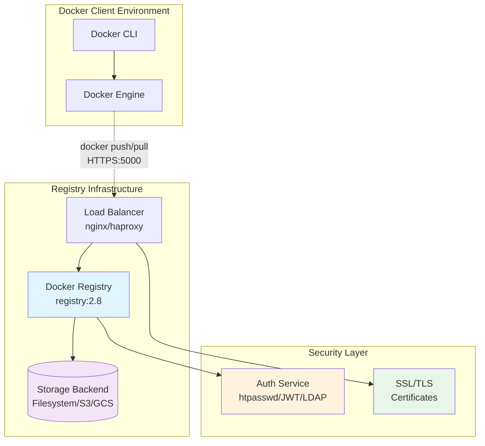

### Registry Component Breakdown
- **Docker Registry**: Core registry service handling push/pull operations
- **Storage Backend**: Persistent storage for image layers and metadata
- **Authentication**: Security layer for user access control
- **Load Balancer**: SSL termination and traffic distribution

---

## 🔐 Authentication Flow Architecture

```mermaid
sequenceDiagram
    participant Client as Docker Client
    participant LB as Load Balancer
    participant Registry as Registry Service
    participant Auth as Auth Service
    participant Storage as Storage Backend
    
    Note over Client,Storage: Pull Request Authentication Flow
    
    Client->>+LB: GET /v2/myapp/manifests/latest
    LB->>+Registry: Forward request
    Registry->>-LB: 401 Unauthorized + WWW-Authenticate header
    LB->>-Client: 401 + Auth challenge
    
    Client->>+Auth: POST /auth/token (username/password)
    Auth->>Auth: Validate credentials
    Auth->>-Client: JWT Token
    
    Client->>+LB: GET /v2/myapp/manifests/latest + Authorization: Bearer <token>
    LB->>+Registry: Forward with token
    Registry->>Registry: Validate JWT token
    Registry->>+Storage: Retrieve manifest
    Storage->>-Registry: Manifest data
    Registry->>-LB: 200 OK + Manifest
    LB->>-Client: Manifest response
    
    Note over Client,Storage: Push Request Flow (Similar with scope validation)
    
    style Auth fill:#fff3e0
    style Registry fill:#e1f5fe
    style Storage fill:#f3e5f5
```

### Authentication Components
- **Bearer Token**: JWT-based authentication for registry access
- **Scope Validation**: Fine-grained permissions for push/pull operations
- **Token Service**: Centralized authentication and authorization
- **Credential Store**: User database (htpasswd, LDAP, OAuth2)

---

## 🪞 Registry Mirror and Cache Architecture

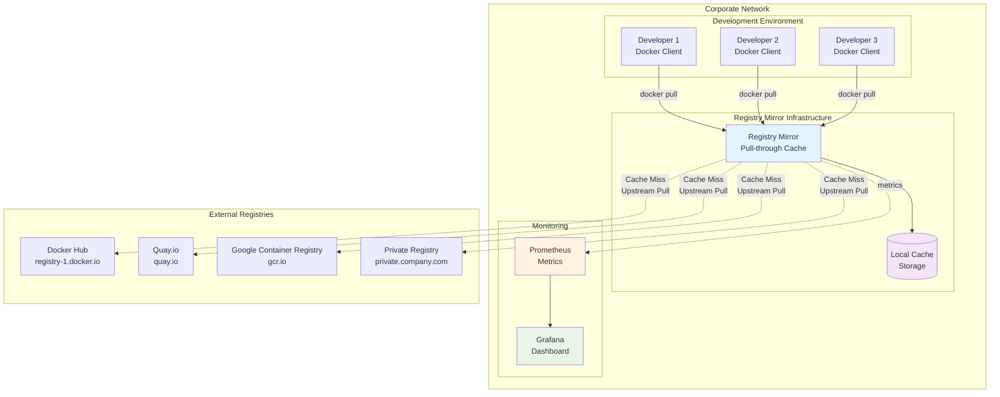

### Mirror Benefits Visualization
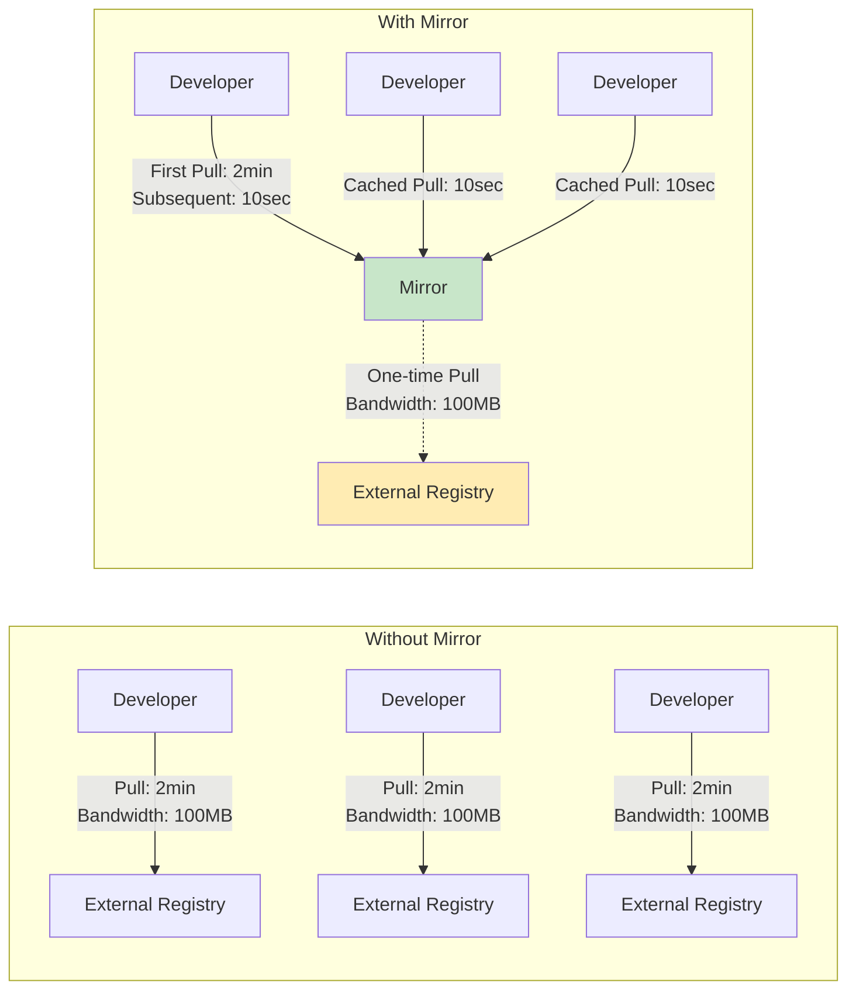

---

## 🏢 Enterprise Registry (Harbor) Architecture

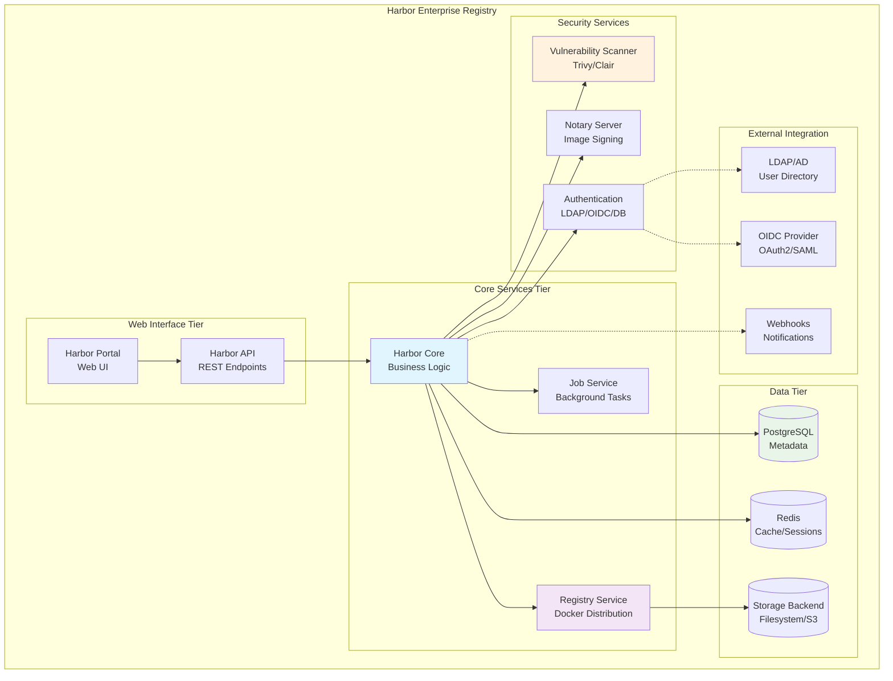

### Harbor Security Architecture
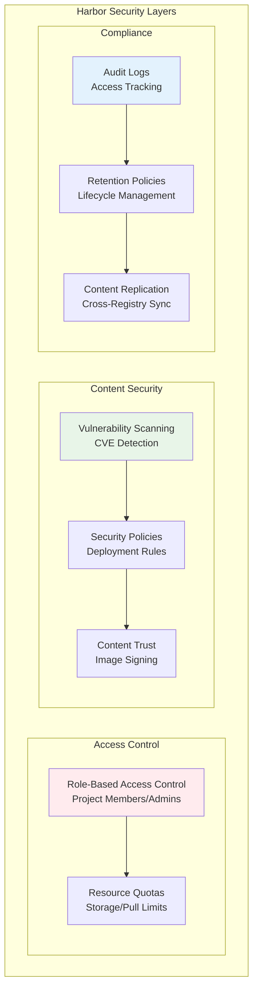

---

## 🔄 High Availability Registry Architecture

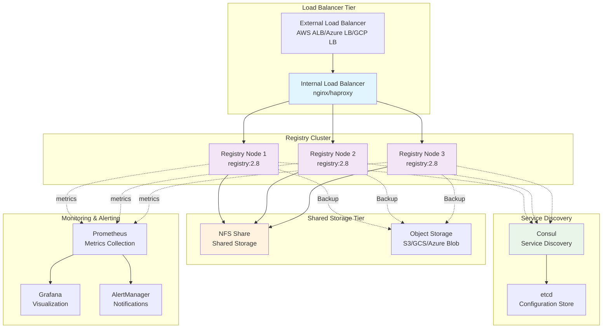

### HA Failover Visualization
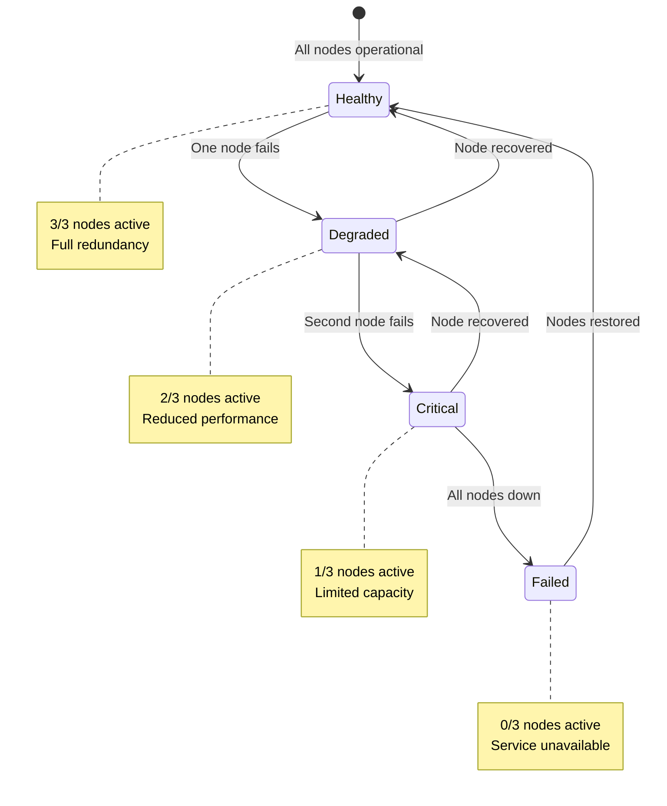

---

## 🔒 Registry Security Architecture

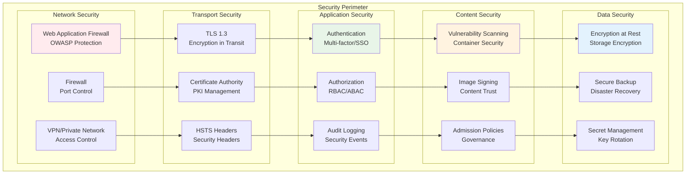

### Security Event Flow
```mermaid
sequenceDiagram
    participant Attacker as Potential Threat
    participant WAF as Web App Firewall
    participant Registry as Registry Service
    participant Scanner as Vulnerability Scanner
    participant SIEM as Security System
    
    Attacker->>+WAF: Malicious request
    WAF->>WAF: Analyze request patterns
    WAF->>-Attacker: Block/Rate limit
    WAF->>SIEM: Log security event
    
    Attacker->>+Registry: Push malicious image
    Registry->>+Scanner: Trigger security scan
    Scanner->>Scanner: Analyze image for vulnerabilities
    Scanner->>-Registry: Security report (vulnerabilities found)
    Registry->>Attacker: Reject push (policy violation)
    Registry->>SIEM: Log policy violation
    
    SIEM->>SIEM: Correlate security events
    SIEM->>SIEM: Generate alert if threshold exceeded
    
    style WAF fill:#ffebee
    style Scanner fill:#fff3e0
    style SIEM fill:#e8f5e8
```

---

## 📊 Registry Performance Metrics

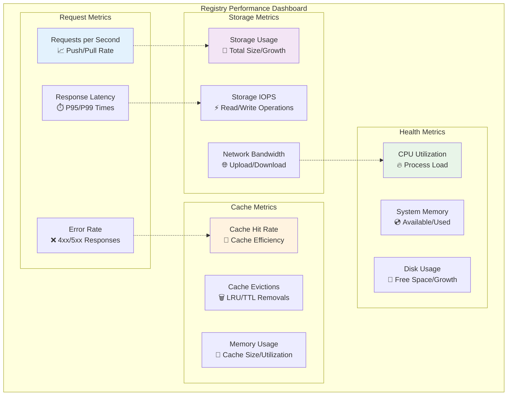

### Performance Optimization Flow
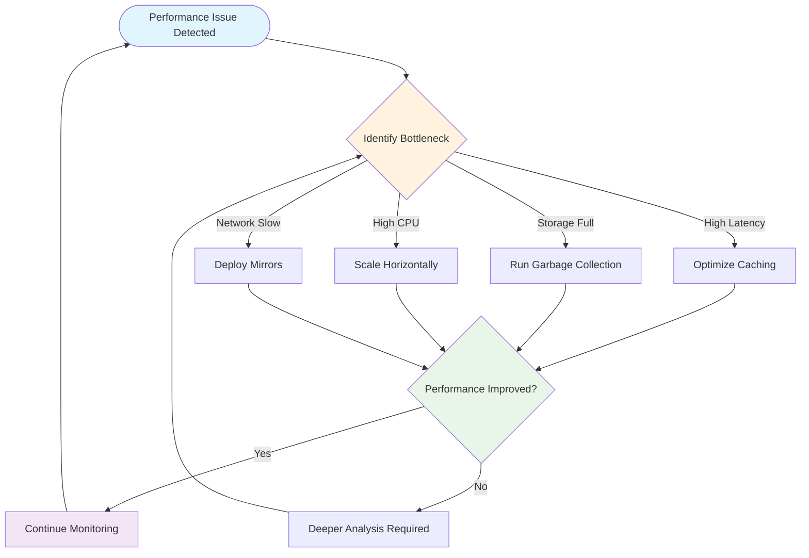

---

## 🔄 Registry Lifecycle Management

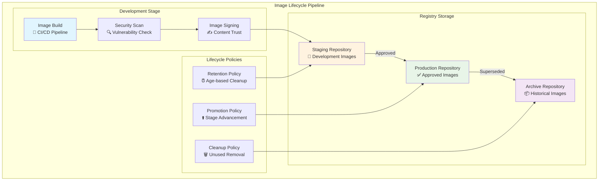

### Retention Policy Visualization
```mermaid
gantt
    title Registry Image Retention Timeline
    dateFormat X
    axisFormat %d days
    
    section Development Images
    Keep Latest 10 Versions    :done, dev1, 0, 30
    Cleanup Older Versions     :crit, dev2, 30, 31
    
    section Staging Images
    Keep Latest 5 Versions     :done, stage1, 0, 60
    Cleanup Older Versions     :crit, stage2, 60, 61
    
    section Production Images
    Keep Latest 3 Versions     :done, prod1, 0, 90
    Archive Older Versions     :done, prod2, 90, 365
    Delete Ancient Versions    :crit, prod3, 365, 366
    
    section Security Updates
    Immediate Cleanup          :crit, sec1, 0, 1
    Force Update Required      :crit, sec2, 1, 7
```

---

## 🌐 Multi-Registry Federation

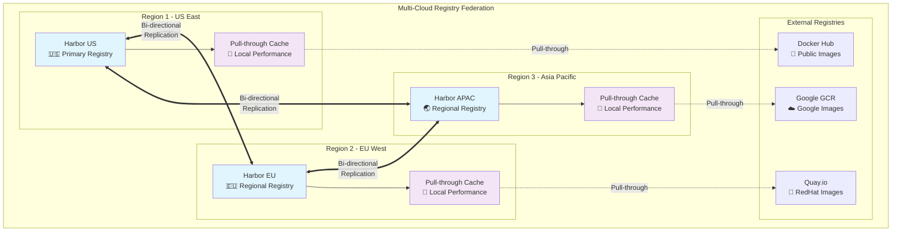

### Federation Synchronization Flow
```mermaid
sequenceDiagram
    participant Dev as Developer (US)
    participant RegUS as Registry US
    participant RegEU as Registry EU
    participant RegAsia as Registry APAC
    participant DevAsia as Developer (APAC)
    
    Dev->>+RegUS: Push myapp:v1.0
    RegUS->>RegUS: Store image locally
    RegUS->>-Dev: Push successful
    
    Note over RegUS,RegEU: Replication Trigger
    RegUS->>+RegEU: Replicate myapp:v1.0
    RegEU->>RegEU: Store replicated image
    RegEU->>-RegUS: Replication complete
    
    Note over RegEU,RegAsia: Chain Replication
    RegEU->>+RegAsia: Replicate myapp:v1.0
    RegAsia->>RegAsia: Store replicated image
    RegAsia->>-RegEU: Replication complete
    
    Note over RegAsia,DevAsia: Local Pull (Fast)
    DevAsia->>+RegAsia: Pull myapp:v1.0
    RegAsia->>-DevAsia: Serve from local storage
    
    style RegUS fill:#e1f5fe
    style RegEU fill:#e1f5fe
    style RegAsia fill:#e1f5fe
```

---

## 📋 Visual Summary Checklist

### Architecture Understanding
- [ ] Basic registry components and interactions
- [ ] Authentication and authorization flows
- [ ] Mirror and caching architectures
- [ ] Enterprise registry features and services

### Security Visualization
- [ ] Multi-layered security architecture
- [ ] Content trust and image signing flows
- [ ] Vulnerability scanning integration
- [ ] Audit and compliance tracking

### Performance and Scaling
- [ ] High availability configurations
- [ ] Load balancing and distribution
- [ ] Performance metrics and monitoring
- [ ] Scaling patterns and bottlenecks

### Operational Workflows
- [ ] Image lifecycle management
- [ ] Retention and cleanup policies
- [ ] Multi-registry federation
- [ ] Disaster recovery scenarios

---

💡 **Visual Learning Success**: These diagrams provide comprehensive understanding of registry architectures, from basic setups to complex enterprise deployments with security, performance, and operational excellence.