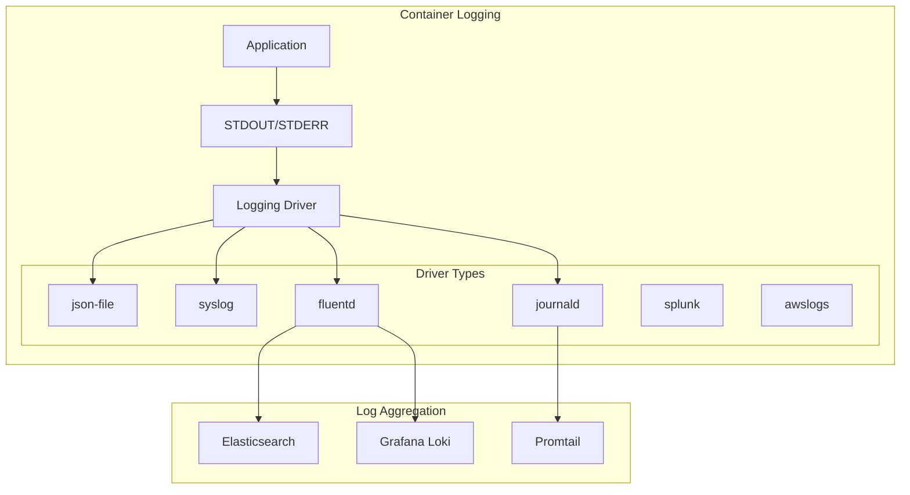

# Phase 10: Docker Observability - Monitoring, Logging, and Tracing

> **Objective**: Master Docker observability through comprehensive monitoring, centralized logging, distributed tracing, and performance analysis for production container environments.

## 📚 Table of Contents

1. [Introduction](#introduction)
2. [Logging Drivers and Strategies](#logging-drivers-and-strategies)
3. [Metrics Collection and Monitoring](#metrics-collection-and-monitoring)
4. [Container and Image Analysis](#container-and-image-analysis)
5. [Performance Monitoring and Optimization](#performance-monitoring-and-optimization)
6. [Distributed Tracing](#distributed-tracing)
7. [Alerting and Incident Response](#alerting-and-incident-response)
8. [Observability Stack Implementation](#observability-stack-implementation)
9. [Best Practices](#best-practices)
10. [Micro-Lessons](#micro-lessons)

## Introduction

Observability in Docker environments encompasses three pillars: **metrics** (what's happening), **logs** (why it's happening), and **traces** (how requests flow). This phase covers comprehensive monitoring strategies, from basic container logs to enterprise observability platforms.

### Key Learning Outcomes
- Configure and optimize Docker logging drivers
- Implement metrics collection with Prometheus and Grafana
- Analyze container resource usage and performance
- Deploy distributed tracing for microservices
- Build production-ready observability stacks

## Logging Drivers and Strategies

### Docker Logging Architecture



### Logging Driver Configuration

#### JSON File Driver (Default)
```bash
# Configure with options
docker run -d \
  --name app \
  --log-driver json-file \
  --log-opt max-size=10m \
  --log-opt max-file=3 \
  --log-opt labels=environment,version \
  --log-opt env=LOG_LEVEL,SERVICE_NAME \
  --label environment=production \
  --label version=1.0.0 \
  -e LOG_LEVEL=info \
  -e SERVICE_NAME=api \
  myapp:latest

# View logs with filters
docker logs --since 2h --until 1h app
docker logs -f --tail 50 app
```

#### Fluentd Driver
```yaml
# docker-compose.yml with Fluentd
version: '3.8'

services:
  app:
    image: myapp:latest
    logging:
      driver: fluentd
      options:
        fluentd-address: localhost:24224
        tag: docker.{{.Name}}
        fluentd-async: "true"
        fluentd-buffer-limit: "1MB"
    depends_on:
      - fluentd

  fluentd:
    image: fluent/fluentd:latest
    ports:
      - "24224:24224"
      - "24224:24224/udp"
    volumes:
      - ./fluent.conf:/fluentd/etc/fluent.conf:ro
      - fluentd-data:/fluentd/log
    environment:
      FLUENTD_CONF: fluent.conf

volumes:
  fluentd-data:
```

#### Fluentd Configuration
```ruby
# fluent.conf
<source>
  @type forward
  port 24224
  bind 0.0.0.0
</source>

# Parse Docker logs
<filter docker.**>
  @type parser
  key_name log
  reserve_data true
  <parse>
    @type json
  </parse>
</filter>

# Add metadata
<filter docker.**>
  @type record_transformer
  <record>
    hostname ${hostname}
    timestamp ${time}
    container_name ${tag_parts[1]}
  </record>
</filter>

# Output to Elasticsearch
<match docker.**>
  @type elasticsearch
  host elasticsearch
  port 9200
  logstash_format true
  logstash_prefix docker
  flush_interval 10s
</match>
```

### Centralized Logging with ELK Stack

```yaml
# elk-stack.yml
version: '3.8'

services:
  elasticsearch:
    image: docker.elastic.co/elasticsearch/elasticsearch:8.11.0
    environment:
      - discovery.type=single-node
      - xpack.security.enabled=false
      - "ES_JAVA_OPTS=-Xms512m -Xmx512m"
    ports:
      - "9200:9200"
    volumes:
      - elastic-data:/usr/share/elasticsearch/data
    networks:
      - observability

  logstash:
    image: docker.elastic.co/logstash/logstash:8.11.0
    ports:
      - "5000:5000/tcp"
      - "5000:5000/udp"
      - "9600:9600"
    volumes:
      - ./logstash/pipeline:/usr/share/logstash/pipeline:ro
    environment:
      - "LS_JAVA_OPTS=-Xms256m -Xmx256m"
    depends_on:
      - elasticsearch
    networks:
      - observability

  kibana:
    image: docker.elastic.co/kibana/kibana:8.11.0
    ports:
      - "5601:5601"
    environment:
      - ELASTICSEARCH_HOSTS=http://elasticsearch:9200
    depends_on:
      - elasticsearch
    networks:
      - observability

volumes:
  elastic-data:

networks:
  observability:
    driver: bridge
```

## Metrics Collection and Monitoring

### Prometheus and Grafana Stack

```yaml
# monitoring-stack.yml
version: '3.8'

services:
  prometheus:
    image: prom/prometheus:latest
    command:
      - '--config.file=/etc/prometheus/prometheus.yml'
      - '--storage.tsdb.path=/prometheus'
      - '--web.console.libraries=/usr/share/prometheus/console_libraries'
      - '--web.console.templates=/usr/share/prometheus/consoles'
      - '--web.enable-lifecycle'
    ports:
      - "9090:9090"
    volumes:
      - ./prometheus/prometheus.yml:/etc/prometheus/prometheus.yml:ro
      - ./prometheus/alerts.yml:/etc/prometheus/alerts.yml:ro
      - prometheus-data:/prometheus
    networks:
      - monitoring

  grafana:
    image: grafana/grafana:latest
    ports:
      - "3000:3000"
    environment:
      - GF_SECURITY_ADMIN_PASSWORD=admin
      - GF_INSTALL_PLUGINS=grafana-piechart-panel
    volumes:
      - ./grafana/provisioning:/etc/grafana/provisioning:ro
      - ./grafana/dashboards:/var/lib/grafana/dashboards:ro
      - grafana-data:/var/lib/grafana
    depends_on:
      - prometheus
    networks:
      - monitoring

  node-exporter:
    image: prom/node-exporter:latest
    ports:
      - "9100:9100"
    command:
      - '--path.procfs=/host/proc'
      - '--path.sysfs=/host/sys'
      - '--path.rootfs=/host'
      - '--collector.filesystem.mount-points-exclude=^/(sys|proc|dev|host|etc)($$|/)'
    volumes:
      - /proc:/host/proc:ro
      - /sys:/host/sys:ro
      - /:/host:ro
    networks:
      - monitoring

  cadvisor:
    image: gcr.io/cadvisor/cadvisor:latest
    ports:
      - "8080:8080"
    volumes:
      - /:/rootfs:ro
      - /var/run:/var/run:ro
      - /sys:/sys:ro
      - /var/lib/docker/:/var/lib/docker:ro
      - /dev/disk/:/dev/disk:ro
    privileged: true
    devices:
      - /dev/kmsg
    networks:
      - monitoring

volumes:
  prometheus-data:
  grafana-data:

networks:
  monitoring:
    driver: bridge
```

### Prometheus Configuration
```yaml
# prometheus.yml
global:
  scrape_interval: 15s
  evaluation_interval: 15s

alerting:
  alertmanagers:
    - static_configs:
        - targets:
          - alertmanager:9093

rule_files:
  - "alerts.yml"

scrape_configs:
  - job_name: 'prometheus'
    static_configs:
      - targets: ['localhost:9090']

  - job_name: 'node'
    static_configs:
      - targets: ['node-exporter:9100']

  - job_name: 'cadvisor'
    static_configs:
      - targets: ['cadvisor:8080']

  - job_name: 'docker'
    static_configs:
      - targets: ['docker-host:9323']

  # Service discovery for containers
  - job_name: 'containers'
    docker_sd_configs:
      - host: unix:///var/run/docker.sock
    relabel_configs:
      - source_labels: [__meta_docker_container_name]
        regex: '/(.*)'
        target_label: container_name
      - source_labels: [__meta_docker_container_label_com_docker_compose_service]
        target_label: service
```

### Container Metrics with cAdvisor

```bash
# Deploy cAdvisor for container metrics
docker run -d \
  --name cadvisor \
  --restart always \
  -p 8080:8080 \
  --volume /:/rootfs:ro \
  --volume /var/run:/var/run:ro \
  --volume /sys:/sys:ro \
  --volume /var/lib/docker/:/var/lib/docker:ro \
  --volume /dev/disk/:/dev/disk:ro \
  --privileged \
  --device /dev/kmsg \
  gcr.io/cadvisor/cadvisor:latest

# Query metrics
curl http://localhost:8080/metrics | grep container_memory_usage_bytes
```

## Container and Image Analysis

### Docker System Analysis
```bash
#!/bin/bash
# docker-analysis.sh

echo "=== Docker System Overview ==="
docker system df

echo -e "\n=== Container Resource Usage ==="
docker stats --no-stream --format "table {{.Container}}\t{{.CPUPerc}}\t{{.MemUsage}}\t{{.NetIO}}\t{{.BlockIO}}"

echo -e "\n=== Top CPU Consumers ==="
docker stats --no-stream --format "{{.Container}}\t{{.CPUPerc}}" | sort -k2 -rn | head -5

echo -e "\n=== Top Memory Consumers ==="
docker stats --no-stream --format "{{.Container}}\t{{.MemPerc}}" | sort -k2 -rn | head -5

echo -e "\n=== Image Size Analysis ==="
docker images --format "table {{.Repository}}:{{.Tag}}\t{{.Size}}" | sort -k2 -hr | head -10

echo -e "\n=== Dangling Resources ==="
echo "Dangling Images: $(docker images -f dangling=true -q | wc -l)"
echo "Stopped Containers: $(docker ps -aq -f status=exited | wc -l)"
echo "Unused Volumes: $(docker volume ls -qf dangling=true | wc -l)"
echo "Unused Networks: $(docker network ls -q | wc -l)"
```

### Image Layer Analysis
```bash
# Dive tool for image analysis
docker run --rm -it \
  -v /var/run/docker.sock:/var/run/docker.sock \
  wagoodman/dive:latest myapp:latest

# Docker history for layer inspection
docker history --no-trunc --format "table {{.CreatedBy}}\t{{.Size}}" myapp:latest

# Export image for analysis
docker save myapp:latest | tar -tv | head -20
```

### Resource Monitoring Script
```python
#!/usr/bin/env python3
# container-monitor.py

import docker
import json
import time
from datetime import datetime

client = docker.from_env()

def get_container_stats():
    stats = []
    for container in client.containers.list():
        try:
            # Get real-time stats
            stat = container.stats(stream=False)
            
            # Calculate CPU percentage
            cpu_delta = stat['cpu_stats']['cpu_usage']['total_usage'] - \
                       stat['precpu_stats']['cpu_usage']['total_usage']
            system_delta = stat['cpu_stats']['system_cpu_usage'] - \
                          stat['precpu_stats']['system_cpu_usage']
            cpu_percent = (cpu_delta / system_delta) * 100.0
            
            # Calculate memory usage
            mem_usage = stat['memory_stats']['usage']
            mem_limit = stat['memory_stats']['limit']
            mem_percent = (mem_usage / mem_limit) * 100.0
            
            stats.append({
                'container': container.name,
                'cpu_percent': round(cpu_percent, 2),
                'memory_mb': round(mem_usage / 1024 / 1024, 2),
                'memory_percent': round(mem_percent, 2),
                'timestamp': datetime.now().isoformat()
            })
        except Exception as e:
            print(f"Error getting stats for {container.name}: {e}")
    
    return stats

def monitor_containers(interval=5):
    while True:
        stats = get_container_stats()
        print(json.dumps(stats, indent=2))
        
        # Alert on high resource usage
        for stat in stats:
            if stat['cpu_percent'] > 80:
                print(f"⚠️  HIGH CPU: {stat['container']} using {stat['cpu_percent']}%")
            if stat['memory_percent'] > 80:
                print(f"⚠️  HIGH MEMORY: {stat['container']} using {stat['memory_percent']}%")
        
        time.sleep(interval)

if __name__ == "__main__":
    monitor_containers()
```

## Performance Monitoring and Optimization

### Performance Metrics Dashboard
```yaml
# grafana-dashboard.json
{
  "dashboard": {
    "title": "Docker Performance Monitoring",
    "panels": [
      {
        "title": "Container CPU Usage",
        "targets": [
          {
            "expr": "rate(container_cpu_usage_seconds_total[5m]) * 100",
            "legendFormat": "{{container_name}}"
          }
        ]
      },
      {
        "title": "Container Memory Usage",
        "targets": [
          {
            "expr": "container_memory_usage_bytes / 1024 / 1024",
            "legendFormat": "{{container_name}}"
          }
        ]
      },
      {
        "title": "Network I/O",
        "targets": [
          {
            "expr": "rate(container_network_receive_bytes_total[5m])",
            "legendFormat": "RX {{container_name}}"
          },
          {
            "expr": "rate(container_network_transmit_bytes_total[5m])",
            "legendFormat": "TX {{container_name}}"
          }
        ]
      },
      {
        "title": "Disk I/O",
        "targets": [
          {
            "expr": "rate(container_fs_reads_bytes_total[5m])",
            "legendFormat": "Read {{container_name}}"
          },
          {
            "expr": "rate(container_fs_writes_bytes_total[5m])",
            "legendFormat": "Write {{container_name}}"
          }
        ]
      }
    ]
  }
}
```

### Performance Testing
```bash
#!/bin/bash
# performance-test.sh

CONTAINER="myapp"
DURATION=60

echo "Starting performance test for $CONTAINER"

# CPU stress test
docker exec $CONTAINER stress --cpu 2 --timeout ${DURATION}s &

# Memory stress test
docker exec $CONTAINER stress --vm 2 --vm-bytes 128M --timeout ${DURATION}s &

# Monitor during test
for i in $(seq 1 $DURATION); do
  docker stats --no-stream $CONTAINER
  sleep 1
done

# Collect results
echo "Performance test completed"
docker logs $CONTAINER | tail -20
```

## Distributed Tracing

### Jaeger Tracing Setup
```yaml
# jaeger-stack.yml
version: '3.8'

services:
  jaeger:
    image: jaegertracing/all-in-one:latest
    environment:
      - COLLECTOR_ZIPKIN_HOST_PORT=:9411
      - COLLECTOR_OTLP_ENABLED=true
    ports:
      - "5775:5775/udp"
      - "6831:6831/udp"
      - "6832:6832/udp"
      - "5778:5778"
      - "16686:16686"  # UI
      - "14268:14268"
      - "14250:14250"
      - "9411:9411"
    networks:
      - tracing

  # Sample application with tracing
  app:
    image: myapp:latest
    environment:
      - JAEGER_AGENT_HOST=jaeger
      - JAEGER_AGENT_PORT=6831
      - JAEGER_SERVICE_NAME=myapp
      - JAEGER_SAMPLER_TYPE=const
      - JAEGER_SAMPLER_PARAM=1
    depends_on:
      - jaeger
    networks:
      - tracing

networks:
  tracing:
    driver: bridge
```

### OpenTelemetry Integration
```python
# app_with_tracing.py
from opentelemetry import trace
from opentelemetry.exporter.jaeger import JaegerExporter
from opentelemetry.sdk.trace import TracerProvider
from opentelemetry.sdk.trace.export import BatchSpanProcessor
from opentelemetry.instrumentation.flask import FlaskInstrumentor
import os

# Configure tracing
trace.set_tracer_provider(TracerProvider())
tracer = trace.get_tracer(__name__)

# Configure Jaeger exporter
jaeger_exporter = JaegerExporter(
    agent_host_name=os.getenv('JAEGER_AGENT_HOST', 'localhost'),
    agent_port=int(os.getenv('JAEGER_AGENT_PORT', 6831)),
)

span_processor = BatchSpanProcessor(jaeger_exporter)
trace.get_tracer_provider().add_span_processor(span_processor)

# Instrument Flask app
from flask import Flask
app = Flask(__name__)
FlaskInstrumentor().instrument_app(app)

@app.route('/api/data')
def get_data():
    with tracer.start_as_current_span("fetch_data"):
        # Simulate work
        with tracer.start_as_current_span("database_query"):
            time.sleep(0.1)
        
        with tracer.start_as_current_span("process_results"):
            time.sleep(0.05)
        
        return {"status": "success"}
```

## Alerting and Incident Response

### Prometheus Alert Rules
```yaml
# alerts.yml
groups:
  - name: container_alerts
    interval: 30s
    rules:
      - alert: ContainerHighCPU
        expr: rate(container_cpu_usage_seconds_total[5m]) * 100 > 80
        for: 2m
        labels:
          severity: warning
        annotations:
          summary: "Container {{ $labels.container_name }} high CPU usage"
          description: "Container {{ $labels.container_name }} CPU usage is above 80% (current value: {{ $value }}%)"

      - alert: ContainerHighMemory
        expr: (container_memory_usage_bytes / container_spec_memory_limit_bytes) * 100 > 90
        for: 2m
        labels:
          severity: critical
        annotations:
          summary: "Container {{ $labels.container_name }} high memory usage"
          description: "Container {{ $labels.container_name }} memory usage is above 90% (current value: {{ $value }}%)"

      - alert: ContainerDown
        expr: up{job="containers"} == 0
        for: 1m
        labels:
          severity: critical
        annotations:
          summary: "Container {{ $labels.container_name }} is down"
          description: "Container {{ $labels.container_name }} has been down for more than 1 minute"

      - alert: HighDiskUsage
        expr: (node_filesystem_size_bytes - node_filesystem_free_bytes) / node_filesystem_size_bytes * 100 > 85
        for: 5m
        labels:
          severity: warning
        annotations:
          summary: "High disk usage on {{ $labels.instance }}"
          description: "Disk usage is above 85% (current value: {{ $value }}%)"
```

### AlertManager Configuration
```yaml
# alertmanager.yml
global:
  resolve_timeout: 5m
  smtp_smarthost: 'smtp.gmail.com:587'
  smtp_from: 'alerts@example.com'
  smtp_auth_username: 'alerts@example.com'
  smtp_auth_password: 'password'

route:
  group_by: ['alertname', 'cluster', 'service']
  group_wait: 10s
  group_interval: 10s
  repeat_interval: 1h
  receiver: 'team-ops'
  
  routes:
  - match:
      severity: critical
    receiver: 'team-ops-critical'
    continue: true

receivers:
  - name: 'team-ops'
    email_configs:
      - to: 'team-ops@example.com'
        headers:
          Subject: 'Docker Alert: {{ .GroupLabels.alertname }}'

  - name: 'team-ops-critical'
    pagerduty_configs:
      - service_key: 'your-pagerduty-service-key'
    slack_configs:
      - api_url: 'YOUR_SLACK_WEBHOOK_URL'
        channel: '#alerts'
        title: 'Critical Alert'
        text: '{{ range .Alerts }}{{ .Annotations.summary }}{{ end }}'
```

## Observability Stack Implementation

### Complete Observability Stack
```yaml
# observability-complete.yml
version: '3.8'

services:
  # Metrics
  prometheus:
    image: prom/prometheus:latest
    ports:
      - "9090:9090"
    volumes:
      - ./prometheus:/etc/prometheus:ro
      - prometheus-data:/prometheus
    command:
      - '--config.file=/etc/prometheus/prometheus.yml'
      - '--storage.tsdb.retention.time=30d'
    networks:
      - observability

  grafana:
    image: grafana/grafana:latest
    ports:
      - "3000:3000"
    environment:
      - GF_SECURITY_ADMIN_PASSWORD=admin
    volumes:
      - ./grafana:/etc/grafana/provisioning:ro
      - grafana-data:/var/lib/grafana
    networks:
      - observability

  # Logs
  loki:
    image: grafana/loki:latest
    ports:
      - "3100:3100"
    volumes:
      - ./loki:/etc/loki:ro
      - loki-data:/loki
    command: -config.file=/etc/loki/loki-config.yaml
    networks:
      - observability

  promtail:
    image: grafana/promtail:latest
    volumes:
      - ./promtail:/etc/promtail:ro
      - /var/log:/var/log:ro
      - /var/lib/docker/containers:/var/lib/docker/containers:ro
    command: -config.file=/etc/promtail/promtail-config.yaml
    networks:
      - observability

  # Traces
  tempo:
    image: grafana/tempo:latest
    command: ["-config.file=/etc/tempo.yaml"]
    volumes:
      - ./tempo/tempo.yaml:/etc/tempo.yaml:ro
      - tempo-data:/tmp/tempo
    ports:
      - "3200:3200"   # tempo
      - "4317:4317"   # otlp grpc
      - "4318:4318"   # otlp http
    networks:
      - observability

  # Alerts
  alertmanager:
    image: prom/alertmanager:latest
    ports:
      - "9093:9093"
    volumes:
      - ./alertmanager:/etc/alertmanager:ro
      - alertmanager-data:/alertmanager
    command:
      - '--config.file=/etc/alertmanager/alertmanager.yml'
      - '--storage.path=/alertmanager'
    networks:
      - observability

volumes:
  prometheus-data:
  grafana-data:
  loki-data:
  tempo-data:
  alertmanager-data:

networks:
  observability:
    driver: bridge
```

## Best Practices

### 1. Logging Best Practices
- Use structured logging (JSON format)
- Include correlation IDs for request tracing
- Implement log levels appropriately
- Rotate logs to prevent disk exhaustion
- Centralize logs for analysis

### 2. Metrics Best Practices
- Follow Prometheus naming conventions
- Use appropriate metric types (counter, gauge, histogram)
- Include relevant labels but avoid high cardinality
- Set reasonable retention periods
- Create meaningful dashboards

### 3. Tracing Best Practices
- Implement sampling to reduce overhead
- Use semantic conventions for span names
- Include relevant context in spans
- Set up trace correlation with logs
- Monitor trace collection performance

### 4. Performance Optimization
```yaml
# Optimized logging configuration
logging:
  driver: "json-file"
  options:
    max-size: "10m"
    max-file: "3"
    compress: "true"
    labels: "env,service,version"
    tag: "{{.ImageName}}/{{.Name}}/{{.ID}}"
```

### 5. Security Considerations
- Sanitize logs to remove sensitive data
- Implement access controls for monitoring endpoints
- Use TLS for metric and log transmission
- Rotate credentials regularly
- Audit access to observability data

## Micro-Lessons

### Available Micro-Lessons
1. **[Logging Drivers](micro-lessons/01-logging-drivers.md)** - 3 minutes
   - Configure and optimize Docker logging drivers

2. **[Metrics Collection](micro-lessons/02-metrics-collection.md)** - 4 minutes
   - Implement Prometheus metrics and exporters

3. **[Image Analysis](micro-lessons/03-image-analysis.md)** - 3 minutes
   - Analyze and optimize container images

4. **[Performance Budgets](micro-lessons/04-performance-budgets.md)** - 4 minutes
   - Define and enforce performance requirements

---

## Summary

Docker observability provides critical insights into container behavior, performance, and health. This phase equipped you with comprehensive monitoring, logging, and tracing capabilities essential for production container operations.

### Key Takeaways
- **Three Pillars**: Metrics, logs, and traces provide complete observability
- **Centralization**: Aggregate data for efficient analysis and correlation
- **Automation**: Implement alerting and automated responses
- **Performance**: Monitor and optimize container resource usage
- **Standards**: Follow industry best practices and conventions

### Next Phase
[**Phase 11: Advanced Images**](../11-advanced-images/README.md) - Master minimal container images, distroless strategies, and CVE minimization techniques.

---

*Keep monitoring, keep improving, keep observing!* 🔍