# Phase 10 Visuals: Docker Observability Architecture

> **Purpose**: Visual diagrams and architecture overviews for Docker observability implementations  
> **Scope**: Comprehensive visual guide covering monitoring, logging, tracing, and alerting architectures

## 📊 Visual Learning Overview

This visual guide provides:
- Observability architecture diagrams
- Logging infrastructure layouts
- Metrics collection flows
- Distributed tracing patterns
- Performance monitoring dashboards
- Complete observability stack architectures

---

## 🔍 The Three Pillars of Observability

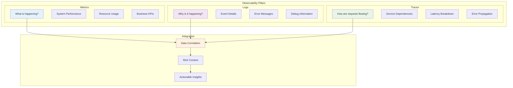

### Observability Data Types
- **Metrics**: Time-series numerical data
- **Logs**: Structured and unstructured event records
- **Traces**: Request journey across service boundaries
- **Events**: Discrete occurrences with context

---

## 📝 Docker Logging Architecture

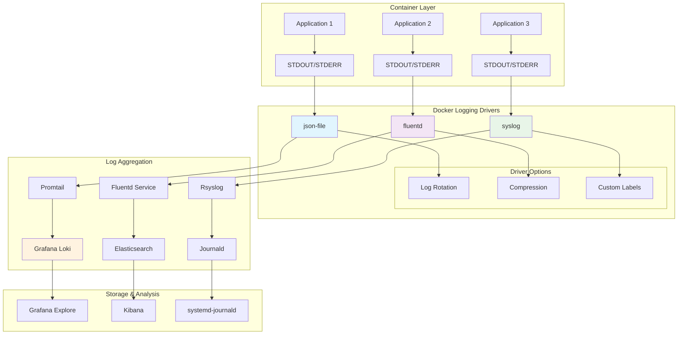

### Logging Driver Comparison
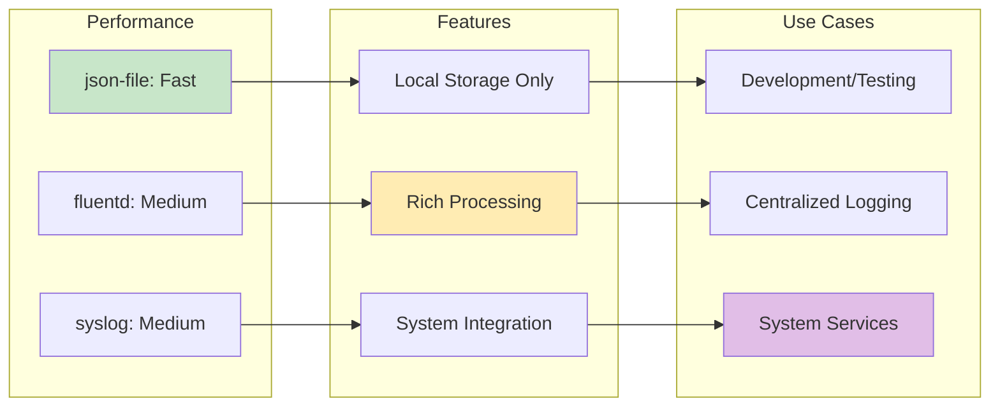

---

## 📊 Metrics Collection Architecture

```mermaid
graph TB
    subgraph "Data Sources"
        subgraph "Host Metrics"
            NODE[Node Exporter]
            HOST_CPU[CPU Usage]
            HOST_MEM[Memory Usage]
            HOST_DISK[Disk I/O]
            HOST_NET[Network Stats]
            
            NODE --> HOST_CPU
            NODE --> HOST_MEM
            NODE --> HOST_DISK
            NODE --> HOST_NET
        end
        
        subgraph "Container Metrics"
            CADVISOR[cAdvisor]
            CONT_CPU[Container CPU]
            CONT_MEM[Container Memory]
            CONT_NET[Container Network]
            CONT_FS[Container Filesystem]
            
            CADVISOR --> CONT_CPU
            CADVISOR --> CONT_MEM
            CADVISOR --> CONT_NET
            CADVISOR --> CONT_FS
        end
        
        subgraph "Application Metrics"
            APP_METRICS[Custom Metrics]
            HTTP_REQ[HTTP Requests]
            ERROR_RATE[Error Rate]
            RESPONSE_TIME[Response Time]
            BUSINESS_KPI[Business KPIs]
            
            APP_METRICS --> HTTP_REQ
            APP_METRICS --> ERROR_RATE
            APP_METRICS --> RESPONSE_TIME
            APP_METRICS --> BUSINESS_KPI
        end
    end
    
    subgraph "Collection Layer"
        PROMETHEUS[Prometheus Server]
        
        NODE --> PROMETHEUS
        CADVISOR --> PROMETHEUS
        APP_METRICS --> PROMETHEUS
    end
    
    subgraph "Storage Layer"
        TSDB[Time Series Database]
        RETENTION[Data Retention]
        COMPRESSION[Data Compression]
        
        PROMETHEUS --> TSDB
        TSDB --> RETENTION
        TSDB --> COMPRESSION
    end
    
    subgraph "Visualization Layer"
        GRAFANA[Grafana]
        DASHBOARD[Dashboards]
        ALERTS[Alerts]
        
        PROMETHEUS --> GRAFANA
        GRAFANA --> DASHBOARD
        GRAFANA --> ALERTS
    end
    
    style PROMETHEUS fill:#ff6b35
    style GRAFANA fill:#f46800
    style CADVISOR fill:#326ce5
```

### Prometheus Scraping Flow
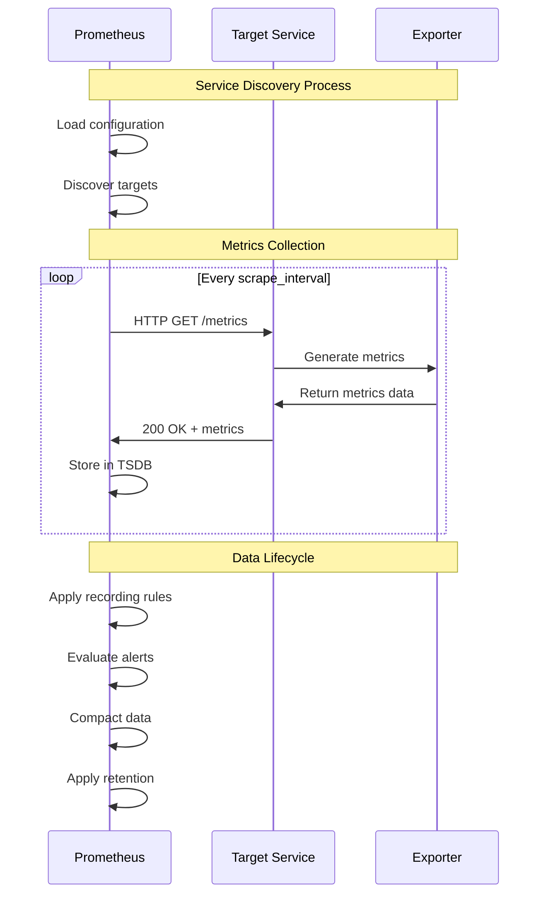

---

## 🔗 Distributed Tracing Architecture

```mermaid
graph TB
    subgraph "Service Mesh"
        subgraph "Frontend Services"
            WEB[Web Service]
            API[API Gateway]
            AUTH[Auth Service]
        end
        
        subgraph "Backend Services"
            USER[User Service]
            ORDER[Order Service]
            PAYMENT[Payment Service]
            INVENTORY[Inventory Service]
        end
        
        subgraph "Data Layer"
            DB1[(User DB)]
            DB2[(Order DB)]
            CACHE[(Redis Cache)]
        end
    end
    
    subgraph "Tracing Infrastructure"
        subgraph "Instrumentation"
            OTEL[OpenTelemetry]
            SPANS[Span Generation]
            CONTEXT[Context Propagation]
        end
        
        subgraph "Collection"
            JAEGER_AGENT[Jaeger Agent]
            JAEGER_COLLECTOR[Jaeger Collector]
            TEMPO[Grafana Tempo]
        end
        
        subgraph "Storage"
            STORAGE[(Trace Storage)]
            INDEX[Trace Index]
            RETENTION_POLICY[Retention Policy]
        end
        
        subgraph "Analysis"
            JAEGER_UI[Jaeger UI]
            GRAFANA_EXPLORE[Grafana Explore]
            SERVICE_MAP[Service Map]
            DEPENDENCY_GRAPH[Dependency Graph]
        end
    end
    
    # Trace flow
    WEB --> API --> AUTH
    API --> USER --> DB1
    API --> ORDER --> DB2
    ORDER --> PAYMENT
    ORDER --> INVENTORY --> CACHE
    
    # Instrumentation
    WEB --> OTEL
    API --> OTEL
    USER --> OTEL
    ORDER --> OTEL
    
    # Collection
    OTEL --> SPANS
    SPANS --> CONTEXT
    SPANS --> JAEGER_AGENT
    JAEGER_AGENT --> JAEGER_COLLECTOR
    JAEGER_COLLECTOR --> STORAGE
    
    # Analysis
    STORAGE --> JAEGER_UI
    STORAGE --> SERVICE_MAP
    
    style OTEL fill:#4285f4
    style JAEGER_COLLECTOR fill:#326ce5
    style JAEGER_UI fill:#1976d2
```

### Trace Correlation with Logs and Metrics
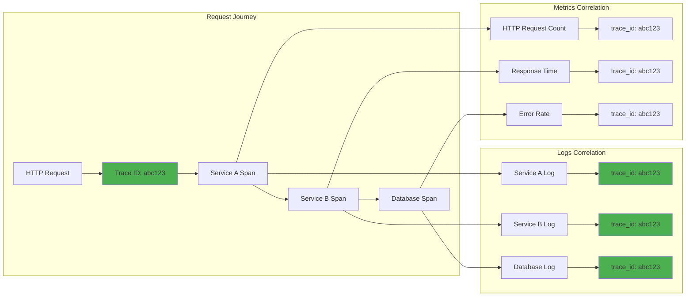

---

## 🚨 Alerting and Incident Response

```mermaid
graph TB
    subgraph "Data Sources"
        PROMETHEUS[Prometheus]
        LOKI[Loki]
        JAEGER[Jaeger]
    end
    
    subgraph "Alert Rules"
        PROM_RULES[Prometheus Rules]
        LOKI_RULES[Loki Rules]
        CUSTOM_RULES[Custom Rules]
        
        subgraph "Rule Types"
            THRESHOLD[Threshold Alerts]
            ANOMALY[Anomaly Detection]
            SLO[SLO Violations]
        end
        
        PROM_RULES --> THRESHOLD
        LOKI_RULES --> ANOMALY
        CUSTOM_RULES --> SLO
    end
    
    subgraph "Alert Manager"
        ALERTMGR[AlertManager]
        GROUPING[Alert Grouping]
        ROUTING[Routing Rules]
        SUPPRESSION[Suppression]
        
        ALERTMGR --> GROUPING
        ALERTMGR --> ROUTING
        ALERTMGR --> SUPPRESSION
    end
    
    subgraph "Notification Channels"
        EMAIL[Email]
        SLACK[Slack]
        PAGERDUTY[PagerDuty]
        WEBHOOK[Webhooks]
        SMS[SMS]
    end
    
    subgraph "Incident Response"
        ONCALL[On-Call Rotation]
        ESCALATION[Escalation Policy]
        RUNBOOK[Runbooks]
        POSTMORTEM[Post-Mortem]
    end
    
    # Flow
    PROMETHEUS --> PROM_RULES
    LOKI --> LOKI_RULES
    
    PROM_RULES --> ALERTMGR
    LOKI_RULES --> ALERTMGR
    CUSTOM_RULES --> ALERTMGR
    
    ALERTMGR --> EMAIL
    ALERTMGR --> SLACK
    ALERTMGR --> PAGERDUTY
    ALERTMGR --> WEBHOOK
    ALERTMGR --> SMS
    
    PAGERDUTY --> ONCALL
    ONCALL --> ESCALATION
    ESCALATION --> RUNBOOK
    RUNBOOK --> POSTMORTEM
    
    style ALERTMGR fill:#ff5722
    style ONCALL fill:#f44336
    style ESCALATION fill:#e91e63
```

### Alert Severity and Response Matrix
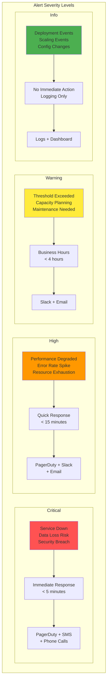

---

## 📊 Performance Monitoring Dashboard

```mermaid
graph TB
    subgraph "Performance Metrics Dashboard"
        subgraph "Infrastructure Layer"
            CPU_PANEL[CPU Utilization<br/>📊 Time Series]
            MEM_PANEL[Memory Usage<br/>📊 Gauge]
            DISK_PANEL[Disk I/O<br/>📊 Graph]
            NET_PANEL[Network Traffic<br/>📊 Area Chart]
        end
        
        subgraph "Container Layer"
            CONT_CPU[Container CPU<br/>📊 Heatmap]
            CONT_MEM[Container Memory<br/>📊 Bar Chart]
            CONT_COUNT[Container Count<br/>📊 Stat Panel]
            CONT_RESTART[Restart Rate<br/>📊 Single Stat]
        end
        
        subgraph "Application Layer"
            REQ_RATE[Request Rate<br/>📊 Line Graph]
            RESPONSE_TIME[Response Time<br/>📊 Histogram]
            ERROR_RATE[Error Rate<br/>📊 Threshold]
            THROUGHPUT[Throughput<br/>📊 Counter]
        end
        
        subgraph "Business Layer"
            ACTIVE_USERS[Active Users<br/>📊 Gauge]
            TRANSACTIONS[Transactions<br/>📊 Bar Chart]
            REVENUE[Revenue<br/>📊 Trend]
            SLA[SLA Compliance<br/>📊 Status Panel]
        end
    end
    
    subgraph "Alert Panels"
        FIRING[Firing Alerts<br/>🚨 Alert List]
        INCIDENTS[Active Incidents<br/>📋 Table]
        SLO_STATUS[SLO Status<br/>✅ Green/Red]
    end
    
    subgraph "Drill-Down Navigation"
        LOGS_LINK[View Logs<br/>🔗 Link to Loki]
        TRACES_LINK[View Traces<br/>🔗 Link to Jaeger]
        DETAIL_DASH[Detailed Dashboard<br/>🔗 Link to Details]
    end
    
    # Relationships
    CPU_PANEL -.->|Drill Down| CONT_CPU
    CONT_CPU -.->|Drill Down| REQ_RATE
    REQ_RATE -.->|Context| LOGS_LINK
    REQ_RATE -.->|Context| TRACES_LINK
    
    ERROR_RATE --> FIRING
    FIRING --> INCIDENTS
    
    style CPU_PANEL fill:#e3f2fd
    style REQ_RATE fill:#f3e5f5
    style ERROR_RATE fill:#ffebee
    style FIRING fill:#ff5252
```

### Performance Monitoring Flow
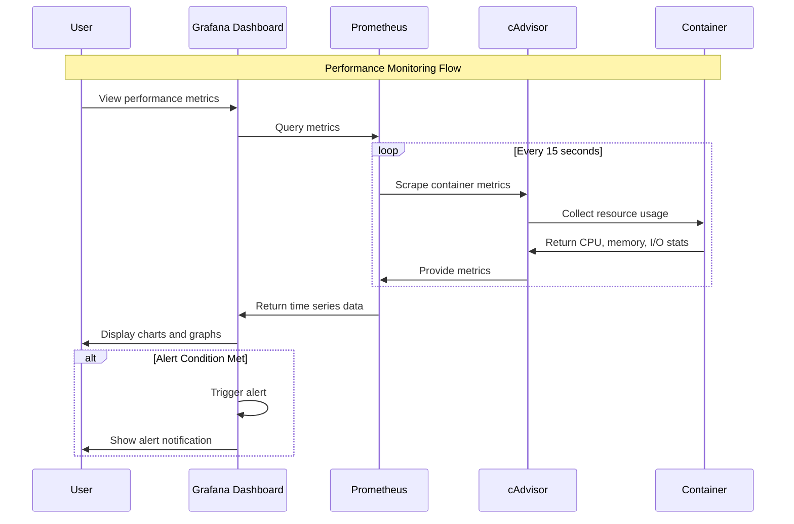

---

## 🏗️ Complete Observability Stack

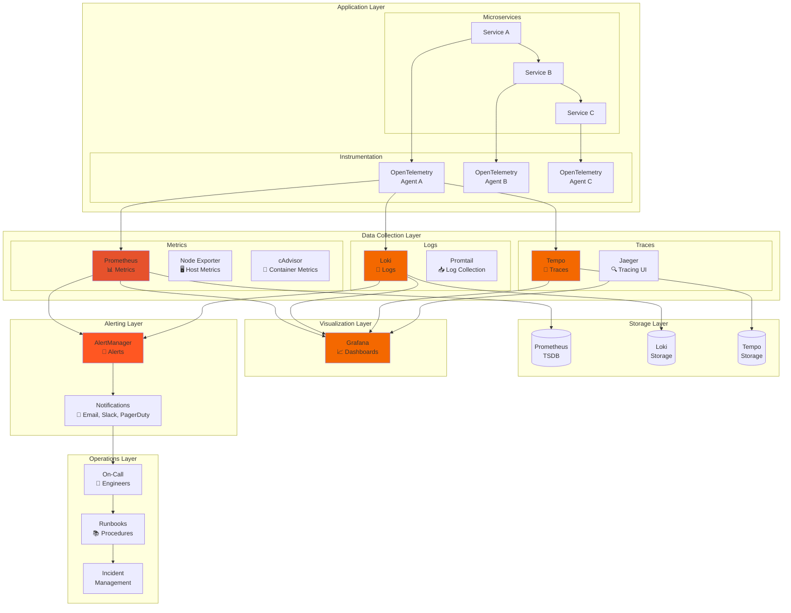

### Data Flow and Integration
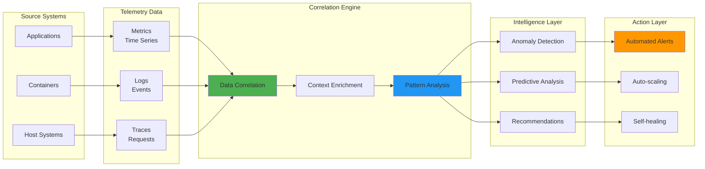

---

## 🎯 SLI/SLO Monitoring

```mermaid
graph TB
    subgraph "Service Level Indicators (SLIs)"
        subgraph "Golden Signals"
            LATENCY[Latency<br/>Response Time<br/>P95 < 500ms]
            TRAFFIC[Traffic<br/>Requests/sec<br/>> 1000 RPS]
            ERRORS[Errors<br/>Error Rate<br/>< 0.1%]
            SATURATION[Saturation<br/>CPU/Memory<br/>< 80%]
        end
        
        subgraph "Custom SLIs"
            AVAILABILITY[Availability<br/>Uptime %<br/>> 99.9%]
            FRESHNESS[Data Freshness<br/>Update Lag<br/>< 5 minutes]
            QUALITY[Data Quality<br/>Valid Records<br/>> 99%]
        end
    end
    
    subgraph "Service Level Objectives (SLOs)"
        SLO_AVAILABILITY[99.9% Availability<br/>Over 30 days]
        SLO_LATENCY[95% of requests<br/>< 500ms response time]
        SLO_ERROR[Error rate < 0.1%<br/>Over rolling 7 days]
    end
    
    subgraph "Error Budget"
        BUDGET_CALC[Error Budget<br/>Calculation]
        BUDGET_BURN[Burn Rate<br/>Monitoring]
        BUDGET_ALERT[Budget Alerts<br/>When < 10%]
    end
    
    subgraph "SLO Dashboards"
        SLO_DASH[SLO Dashboard<br/>📊 Real-time Status]
        ERROR_BUDGET_DASH[Error Budget<br/>📈 Burn Rate]
        TREND_ANALYSIS[Trend Analysis<br/>📉 Historical Data]
    end
    
    # Relationships
    LATENCY --> SLO_LATENCY
    ERRORS --> SLO_ERROR
    AVAILABILITY --> SLO_AVAILABILITY
    
    SLO_LATENCY --> BUDGET_CALC
    SLO_ERROR --> BUDGET_CALC
    SLO_AVAILABILITY --> BUDGET_CALC
    
    BUDGET_CALC --> BUDGET_BURN
    BUDGET_BURN --> BUDGET_ALERT
    
    SLO_AVAILABILITY --> SLO_DASH
    BUDGET_CALC --> ERROR_BUDGET_DASH
    SLO_DASH --> TREND_ANALYSIS
    
    style SLO_AVAILABILITY fill:#4caf50
    style BUDGET_ALERT fill:#ff5722
    style SLO_DASH fill:#2196f3
```

### SLO Alerting Strategy
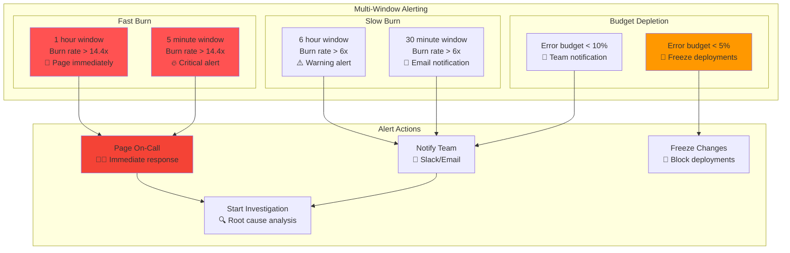

---

## 📋 Visual Summary Checklist

### Architecture Understanding
- [ ] Three pillars of observability (metrics, logs, traces)
- [ ] Docker logging drivers and aggregation
- [ ] Metrics collection and time-series databases
- [ ] Distributed tracing and correlation

### Infrastructure Components
- [ ] Prometheus metrics architecture
- [ ] Grafana visualization layers
- [ ] Loki log aggregation
- [ ] Jaeger/Tempo tracing systems

### Integration Patterns
- [ ] Data correlation strategies
- [ ] Context propagation methods
- [ ] Alert routing and escalation
- [ ] SLI/SLO monitoring frameworks

### Operational Excellence
- [ ] Performance monitoring dashboards
- [ ] Incident response workflows
- [ ] Error budget management
- [ ] Automation and self-healing

---

💡 **Visual Learning Success**: These diagrams provide comprehensive understanding of Docker observability architectures, from basic logging setups to complete production-ready monitoring stacks with metrics, logs, traces, and alerting.